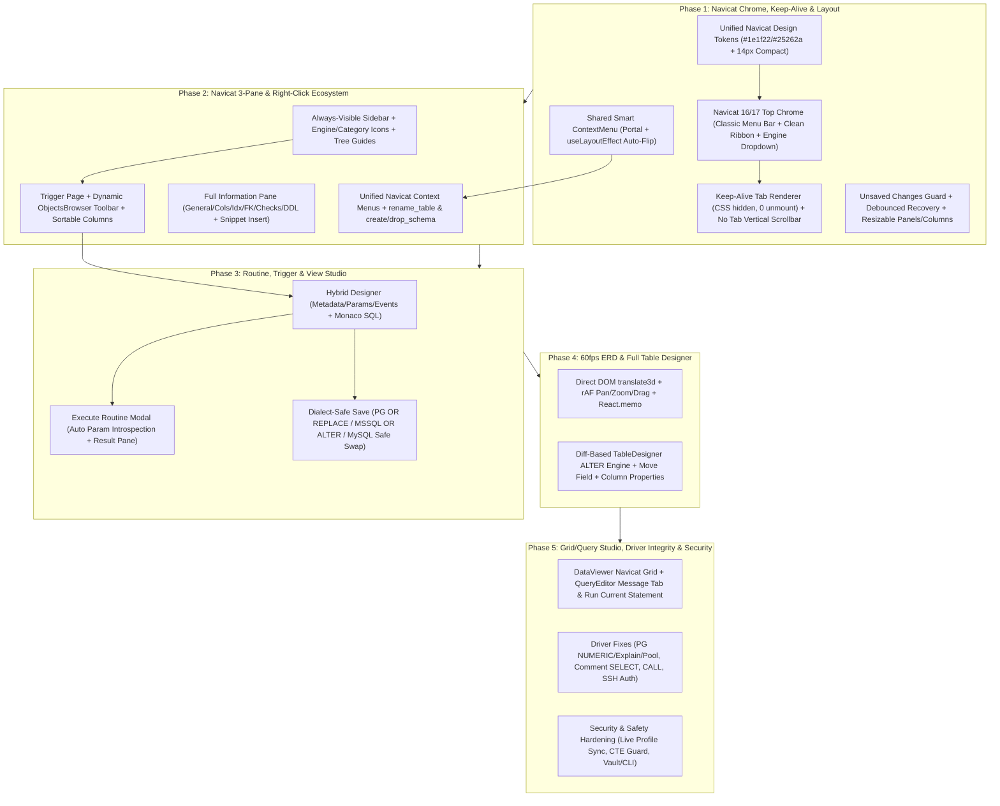

# Product Requirements Document (PRD) — DBa Improvements v2, Navicat Premium UI/UX & Hardening

> **Status:** Draft — Siap Review & Implementasi  
> **Dokumen Induk:** [PRD.md](file:///home/angg/Projects/Desktop/DBa/doc/PRD.md) (Phase 1–5 Selesai ✅) & [PRD-improvement.md](file:///home/angg/Projects/Desktop/DBa/doc/PRD-improvement.md) (Phase 1–4 Selesai ✅)  
> **Sumber Kebutuhan:** [improvement-v2.md](file:///home/angg/Projects/Desktop/DBa/doc/improvement-v2.md) (9 Poin Pengembangan) + Audit UI/UX Navicat Premium (v16/v17) + Audit Menyeluruh Codebase DBa (Bug Kritis, UX/Performa Harian, & Security/Safety)  
> **Target Pengguna:** Personal Daily-Driver (Single-User, Local-First, Cross-Platform Linux/macOS/Windows)  
> **Tujuan Iterasi:** Menyelaraskan tampilan & rasa pakai DBa semirip mungkin dengan **Navicat Premium (v16/v17)** (palet charcoal terpadu, kepadatan desktop `14px`, Menu Bar + Ribbon rapi, 3-pane dengan Information Pane lengkap, DataViewer & QueryEditor khas Navicat), menyelesaikan 9 poin `improvement-v2.md` (keep-alive tab tanpa auto-refresh, tab bar tanpa scrollbar vertikal, menu klik kanan pintar & lengkap, halaman **Trigger**, kategori sidebar *always-visible*, **Hybrid Designer & Runner** untuk Function/Procedure/Trigger/View, ERD 60fps), serta menuntaskan bug kritis `TableDesigner` `ALTER TABLE`, integritas data driver, wizard, dan *security hardening*.

---

## 1. Ringkasan Eksekutif & Cakupan

Setelah iterasi v1 (`PRD-improvement.md`) menyelesaikan dasar ergonomi tab, grid, dan SQL autocomplete, penggunaan harian nyata serta audit UI/UX & teknis menyeluruh pada frontend React/Tauri dan backend Rust (`dba-core` + 4 driver) merumuskan **3 pilar utama** untuk iterasi v2:

1. **9 Poin Pengembangan Langsung (`doc/improvement-v2.md`):** Tab keep-alive tanpa auto-refresh saat pindah tab/menu, penghapusan scrollbar vertikal tab bar, menu klik kanan ala Navicat di `ObjectExplorer` dan `ObjectsBrowser`, optimasi performa 60fps pada ER Diagram, halaman khusus **Triggers**, kategori inti sidebar kiri yang selalu tampil walau kosong, **Create/Edit/Execute** untuk Function/Procedure/Trigger (+ View), serta perbaikan posisi menu klik kanan agar tidak terpotong di baris terakhir tabel.
2. **Navicat Premium (v16/v17) UI/UX Authenticity Overhaul:**
   - **Visual Design System Terpadu & Desktop Density:** Menyatukan seluruh surface dark mode ke palet charcoal Navicat (`#1e1f22` / `#25262a` / `#2b2d31` / `#32343a`) & light mode netral (menghilangkan kontras "belang" `bg-zinc-950` vs `#1e1f22`), menurunkan default `uiFontSize` ke **`14px`** (rentang `12–22px`) dengan kepadatan baris `~26px`.
   - **Top Chrome & Ribbon 16/17:** Tier 1 memuat **Classic Menu Bar** (`File`, `Edit`, `View`, `Tools`) + breadcrumb + Quick Jump + window controls; Tier 2 memuat Ribbon rapi tanpa overflow (`Connection ▾` dropdown pilih engine langsung, `New Query`, `Table/View/Function/Trigger/Query`, `Model/Backup/Sync/Transfer/Import-Export`, `Tools ▾`).
   - **3-Pane Workspace Authenticity:** Ikon engine berwarna (menyala/redup) + ikon kategori + *tree indent guides* di `ObjectExplorer`; sub-toolbar dinamis per kategori & kolom sortable di `ObjectsBrowser`; **Information Pane** lengkap di `RightInspector` (General, Columns, Indexes, FKs, Checks, DDL Preview, plus CRUD Snippets + *Insert at Cursor*).
   - **Workbench Signatures:** Sticky `#` gutter, zebra striping, right-align angka, checkbox inline `boolean`, pagination lengkap (`|<`, `<`, input page, `>`, `>|`), tombol Export & bar *Last Executed SQL* di `DataViewer`; tab **`Message` / `Summary`** & **`Run Current Statement`** (`Ctrl+Shift+Enter`) di `QueryEditor`; *Move Field Up/Down*, *Insert Field*, & panel properti kolom detail di `TableDesigner`.
3. **Perbaikan Kekurangan Aplikasi Hasil Audit Codebase:**
   - **Bug Kritis & Integritas Data (Klaster A):** `TableDesigner` full diff `ALTER TABLE` untuk edit tabel eksisting; strip leading SQL comments `--`/`/* */` pada deteksi `SELECT`; PG `DROP TRIGGER` & MSSQL `DROP INDEX` (tidak lagi salah `DROP TABLE`); PG `EXPLAIN` safe rolled-back; PG tipe `NUMERIC`/array/INET/INTERVAL decoding; PG transaksi terisolasi & evict client pada `DROP DATABASE`; MySQL `CALL` result sets & compound DDL (`DELIMITER`/`GO`/`$tag$`); SSH password/passphrase auth; MySQL dump trailing `;`; MSSQL Data Transfer mempertahankan length/defaults/indexes/FKs (fix `NVARCHAR(1)`); `MongoViewer` manual filter + cache key fix; dropdown DB di 5 wizard & `AutomationWorkbench` JSON editor.
   - **UX & Performa Harian (Klaster B):** Virtualisasi & Export/Copy-as pada hasil `QueryEditor` (plus fix hover putih di dark mode), *Unsaved Changes Guard* saat menutup tab `dirty`, *Resizable Panels & Columns*, debounce simpan recovery SQLite, dan konsistensi Light/System theme.
   - **Security & Safety Hardening (Klaster D):** Live-sync flag `readOnly`/`environment` ke cache koneksi aktif, perbaikan bypass Safety Guard (CTE newline, `WHERE` dalam string, konfirmasi Production pada mutasi & Automation), proteksi atomik `0600` `.vault.local`, penghapusan plaintext password dari argumen CLI proses, serta sanitasi systemd unit.

### Status Progres Implementasi per Phase

| Phase | Fokus Utama | Status |
| :---: | :--- | :---: |
| **Phase 1** | Navicat Visual System, Top Chrome/Ribbon, Keep-Alive Tabs, Smart Context Menu, Resizable & Unsaved Guard | ✅ Selesai |
| **Phase 2** | Navicat 3-Pane Navigation, Halaman Trigger, Always-Visible Sidebar, Information Pane & Unified Right-Click | ✅ Selesai |
| **Phase 3** | Hybrid Routine, Trigger & View Designer + Parameterized Execution Engine | ⬜ Belum Dimulai |
| **Phase 4** | 60fps Native ER Diagram Optimization & Table Designer Full `ALTER TABLE` + Navicat Field UX | ⬜ Belum Dimulai |
| **Phase 5** | Navicat Grid & Query Studio Polish, Driver Data Integrity, Wizard Fixes & Security Hardening | ⬜ Belum Dimulai |

### Pemetaan Kebutuhan `improvement-v2.md` & Navicat UI/UX → Phase

| # | Kebutuhan / Sumber | Area / Komponen Utama | Target Phase | Status |
| :-: | :--- | :--- | :---: | :---: |
| 1 | Tidak perlu refresh setiap ganti menu/tab; refresh manual oleh user *(v2 #1)* | `App.tsx`, `useWorkbenchStore.ts`, `DataViewer.tsx`, `QueryEditor.tsx`, `ObjectsBrowser.tsx` | **Phase 1** | ✅ |
| 2 | Hilangkan scrollbar vertikal di bagian tab *(v2 #2)* | `App.tsx`, `NavicatToolbar.tsx`, `index.css` | **Phase 1** | ✅ |
| 3 | Klik kanan di object sidebar ala Navicat *(v2 #3)* | `ObjectExplorer.tsx`, `ContextMenu.tsx`, `dba-core` (`rename_table`, `create_schema`) | **Phase 2** | ✅ |
| 4 | Optimasi performa ER Diagram agar geser/zoom tidak patah-patah *(v2 #4)* | `ErDiagramDesigner.tsx` | **Phase 4** | ⬜ |
| 5 | Klik kanan di halaman Objects ala Navicat *(v2 #5)* | `ObjectsBrowser.tsx`, `ContextMenu.tsx` | **Phase 2** | ✅ |
| 6 | Tambah, Edit, dan Execution untuk Function, Procedure, Trigger (+ View) *(v2 #6)* | `ObjectScriptDesigner.tsx`, `ExecuteRoutineModal.tsx`, `dba-core` drivers | **Phase 3** | ⬜ |
| 7 | Halaman Trigger belum ada *(v2 #7)* | `NavicatToolbar.tsx`, `ObjectsBrowser.tsx`, `ObjectExplorer.tsx`, `useWorkbenchStore.ts` | **Phase 2** | ✅ |
| 8 | Klik kanan row terakhir tabel terpotong (Delete Row hilang); auto-flip ke atas *(v2 #8)* | `ContextMenu.tsx`, `DataViewer.tsx`, `ObjectExplorer.tsx`, `ObjectsBrowser.tsx` | **Phase 1** | ✅ |
| 9 | Kategori kiri (`Tables`, `Views`, `Functions`, `Triggers`, `Queries`) tetap tampil walau kosong *(v2 #9)* | `ObjectExplorer.tsx` | **Phase 2** | ✅ |
| 10 | Navicat Authentic Visual System (palet charcoal terpadu, default `14px`, Menu Bar + Clean Ribbon) | `index.css`, `NavicatToolbar.tsx`, semua panel utama | **Phase 1** | ✅ |
| 11 | Navicat 3-Pane Polish (engine/category icons, dynamic ObjectsBrowser toolbar, full Information Pane + Snippet Insert) | `ObjectExplorer.tsx`, `ObjectsBrowser.tsx`, `RightInspector.tsx` | **Phase 2** | ✅ |
| 12 | Navicat Workbench Signatures (DataViewer sticky `#`/zebra/bool/pagination/SQL bar, QueryEditor Message tab & Run Current Statement, TableDesigner Move Field & property pane) | `DataViewer.tsx`, `QueryEditor.tsx`, `TableDesigner.tsx` | **Phase 4 & 5** | ⬜ |

### Non-Goals (Di Luar Scope Iterasi v2 Ini)
- **User, Role & Privilege Manager** (`CREATE USER`, `GRANT`/`REVOKE` GUI) — dijadwalkan untuk iterasi v3.
- **Server Monitor / Process List / Session Killer** (`SHOW FULL PROCESSLIST`, `pg_stat_activity`, `sys.dm_exec_sessions`) — dijadwalkan untuk iterasi v3.
- **Migrasi ER Diagram ke library pihak ketiga** (seperti `@xyflow/react`) — tetap menggunakan stack native DOM + SVG ringan tanpa dependency baru.
- **Rewrite total streaming pagination cursor-based** untuk `DataSync` / `ImportExport` skala multi-juta baris & connection pool penuh untuk driver `tiberius` MSSQL — fokus v2 pada perbaikan bug integritas data & performa UI harian.
- **Penambahan engine database baru** di luar 4 engine aktif (PostgreSQL, MySQL/MariaDB, MSSQL, MongoDB).

---

## 2. Arsitektur Perubahan & Aliran Data

---

## 3. Spesifikasi Fungsional Detail

### 3.0 Navicat Premium Visual Design System & Top Chrome (Phase 1)

**Kondisi Saat Ini:**
- Default `uiFontSize` di [useWorkbenchStore.ts](file:///home/angg/Projects/Desktop/DBa/src/store/useWorkbenchStore.ts#L209) adalah `18px`, menyebabkan seluruh komponen membengkak dan kerapatan baris jauh lebih rendah dibanding Navicat desktop.
- Permukaan dark mode terbelah antara palet charcoal Navicat (`#1e1f22`, `#25262a`, `#32343a`) dan hitam pekat (`bg-zinc-950`, `bg-zinc-900`) di `DataViewer`, `QueryEditor`, `TableDesigner`, `ObjectExplorer`, `RightInspector`, dan `BottomDrawer`.
- [NavicatToolbar.tsx](file:///home/angg/Projects/Desktop/DBa/src/components/NavicatToolbar.tsx#L413-L586) menampilkan 15 tombol sejajar tanpa menu bar klasik, tanpa dropdown engine pada tombol `Connection`, dan menduplikasi tombol `New Table`.

**Persyaratan:**
1. **Unified Navicat Surface Tokens & Desktop Compact Density (`src/index.css`, `useWorkbenchStore.ts`, semua komponen):**
   - Definisikan CSS custom properties terpadu untuk **Dark Mode (Navicat Charcoal)** dan **Light Mode (Neutral Crisp)** di `src/index.css`:
     - Dark: `--surface-canvas: #1e1f22`, `--surface-panel: #25262a`, `--surface-elevated: #2b2d31`, `--surface-hover: #31343a`, `--border-subtle: #32343a`, `--border-strong: #3d4048`.
     - Light: `--surface-canvas: #ffffff`, `--surface-panel: #f5f6f8`, `--surface-elevated: #eceef2`, `--surface-hover: #e5e8ee`, `--border-subtle: #dfe2e8`, `--border-strong: #cfd4de`.
   - Migrasikan seluruh panel (`ObjectExplorer`, `ObjectsBrowser`, `DataViewer`, `QueryEditor`, `TableDesigner`, `RightInspector`, `BottomDrawer`, `MongoViewer`, `MongoQueryEditor`, `ErDiagramDesigner`, wizards) agar memakai token warna seragam (tidak ada lagi panel "belang" `bg-zinc-950` atau kelas dark hardcoded tanpa prefix `dark:`).
   - Ubah default `uiFontSize` menjadi **`14px`** dengan rentang clamp **`12px` – `22px`** (tetap dapat disesuaikan user lewat `A-` / `A+`), dan rapatkan tinggi baris tree/grid ke **`~26px`** agar informasi tampil padat & tajam seperti Navicat Premium.
2. **Navicat 16/17 Authentic Top Chrome (`NavicatToolbar.tsx`):**
   - **Tier 1 (Title Bar + Classic Menu Bar):**
     - Kiri: Logo `DBa` + **Classic Menu Dropdowns**:
       - **`File`**: New Connection (submenu per engine), New Query (`Ctrl+T`), Save (`Ctrl+S`), Save As, Close Tab (`Ctrl+W`), Close All Tabs, Exit.
       - **`Edit`**: Cut/Copy/Paste, Format SQL (`Ctrl+Shift+F`), Find / Quick Jump (`Ctrl+K`).
       - **`View`**: Toggle Navigation Pane, Toggle Information Pane, Toggle Console/History Drawer, Split Side-by-Side, Split Top-Bottom, Theme (Dark/Light/System), Zoom (`A-`/`A+`/`Reset 14px`).
       - **`Tools`**: Data Transfer, Structure & Data Sync, Dump & Backup, Import/Export, ER Diagram Model, Visual Query Builder, Charts Dashboard, Automation, Data Generator.
     - Tengah: Breadcrumb koneksi/database/schema aktif + badge Read-Only (`RO`) / Production banner.
     - Kanan: Tombol `Quick Jump... Ctrl+K`, kontrol `A- / 14 / A+`, split/theme/panel toggles, dan Window Controls (`Minimize`, `Maximize/Restore`, `Close`).
   - **Tier 2 (Clean Iconic Ribbon — Zero Overflow di 1280px+):**
     - Grup 1 (Core): **`Connection ▾`** (klik membuka dropdown pilih engine langsung: *PostgreSQL*, *MySQL / MariaDB*, *SQL Server*, *MongoDB* → langsung membuka `ConnectionModal` dengan engine terpilih!), **`New Query`**.
     - Grup 2 (Object Categories): **`Table`**, **`View`**, **`Function`**, **`Trigger`**, **`Query`** *(menghapus tombol `New Table` duplikat dari ribbon karena sudah kontekstual di sub-toolbar `ObjectsBrowser` dan klik kanan)*.
     - Grup 3 (Power Tools): **`Model`**, **`Backup`**, **`Sync`**, **`Transfer`**, **`Import/Export`**, dan **`Tools ▾`** dropdown (*Query Builder*, *Charts Dashboard*, *Automation*, *Data Generator*).
   - Hapus dead stub `notifyPhase`.

---

### 3.1 Keep-Alive Tab Container & Kebijakan Refresh Manual (Phase 1)

**Kondisi Saat Ini:**
- [App.tsx](file:///home/angg/Projects/Desktop/DBa/src/App.tsx#L519-L521) merender `{activeTab && <TabContent key={activeTab.id} tab={activeTab} />}`. Setiap perpindahan tab meng-unmount komponen sebelumnya dan me-remount tab tujuan, sehingga `DataViewer`, `MongoViewer`, `ErDiagramDesigner`, `TableDesigner`, dan `QueryEditor` mengeksekusi query ulang serta menghilangkan posisi scroll, filter, dan *staged edits*.

**Persyaratan:**
1. **CSS-Hidden Keep-Alive Rendering (`src/App.tsx`):**
   - Render seluruh tab yang terbuka di dalam container utama, dengan tab aktif memiliki `block h-full w-full` dan tab tidak aktif `hidden` (`display: none`) sehingga state React, data grid, posisi scroll, hasil query, dan draft editor tetap utuh di memori.
   - **Penanganan Split Pane:** Jika `splitMode !== "none"` dan `secondaryTabId` menunjuk ke tab berbeda dari `activeTabId`, tampilkan tab sekunder di split pane tanpa men-double-mount instance yang sama jika `secondaryTabId === activeTabId` (tampilkan banner info *"Select a different tab to compare side-by-side"* bila sama).
   - **Monaco Layout Sync:** Saat tab `QueryEditor`, `MongoQueryEditor`, atau `ObjectScriptDesigner` kembali menjadi aktif (`activeTabId === tab.id`), panggil `editorRef.current?.layout()` di `useEffect` agar ukuran canvas Monaco tidak menyusut saat kembali dari `display: none`.
2. **Kebijakan Refresh Manual & Mutasi Eksplisit:**
   - **Pertama kali dibuka:** Tab tabel/koleksi dan kategori database melakukan *initial fetch* satu kali.
   - **Berpindah tab atau pindah menu/kategori (`Table`/`View`/`Function`/`Trigger`/`Query`):** Tidak pernah melakukan *auto-refetch* ke database; selalu menampilkan data/cache yang sudah ada di memori.
   - **Refresh Manual:** User dapat me-refresh kapan saja melalui tombol **Refresh**, shortcut `F5` / `Ctrl+R` (saat tab `Objects` atau `DataViewer` aktif), atau menu klik kanan **Refresh**.
   - **Refresh Pasca Mutasi Eksplisit:** Aksi yang jelas mengubah skema/data dari dalam aplikasi (*Apply Staged Changes*, *Create/Drop/Rename Table/Database/Schema*, *Create/Drop/Edit Routine/Trigger/View*, *Paste Object*) tetap menyegarkan cache objek/grid terkait agar tampilan selalu konsisten dengan hasil aksi user.

---

### 3.2 Perbaikan Scrollbar Vertikal Tab Bar & Ribbon (Phase 1)

**Kondisi Saat Ini:**
- [App.tsx](file:///home/angg/Projects/Desktop/DBa/src/App.tsx#L346) menggunakan `overflow-x-auto` tanpa `overflow-y-hidden`, ditambah active tab memakai `-mb-px pb-px` dan `h-8` di dalam `h-9`, memicu scrollbar vertikal muncul pada tab bar di Linux WebKitGTK. Kondisi serupa ada pada [NavicatToolbar.tsx](file:///home/angg/Projects/Desktop/DBa/src/components/NavicatToolbar.tsx#L413).

**Persyaratan:**
1. Tambahkan `overflow-y-hidden` secara eksplisit pada container tab bar (`App.tsx`) dan ribbon toolbar (`NavicatToolbar.tsx`).
2. Gunakan styling scrollbar horizontal tipis/tersembunyi khusus tab bar (`.tab-bar-scroll` di `src/index.css` dengan `height: 3px` / `scrollbar-width: none` + dukung scroll horizontal via mouse wheel pada tab bar), dan pastikan tinggi tab aktif tidak pernah memicu vertical overflow pada seluruh ukuran `uiFontSize` (`12px`–`22px`).

---

### 3.3 Smart Viewport-Aware Context Menu Bersama (Phase 1)

**Kondisi Saat Ini:**
- [DataViewer.tsx](file:///home/angg/Projects/Desktop/DBa/src/components/DataViewer.tsx#L1369-L1373) meng-hardcode `menuH = 440` padahal tinggi aktual menu klik kanan cell ~600px+, sehingga opsi **Add Row / Duplicate Row / Delete Row** terpotong di bawah layar saat klik kanan baris terakhir.
- [ObjectExplorer.tsx](file:///home/angg/Projects/Desktop/DBa/src/components/ObjectExplorer.tsx#L664-L665) tidak melakukan viewport clamping sama sekali pada menu Connection/Database/Object.

**Persyaratan:**
1. **Komponen Reusable `src/components/ContextMenu.tsx`:**
   - Dirender via `createPortal(..., document.body)` dengan `fixed z-50` agar tidak pernah terpotong `overflow: hidden` parent.
   - Menggunakan `useLayoutEffect` untuk mengukur dimensi aktual `menuRef.current.getBoundingClientRect()`:
     - **Vertikal:** Jika `anchor.y + rect.height > window.innerHeight - 8`, otomatis **flip ke atas** (`top = anchor.y - rect.height`); jika masih keluar atas (`< 8`), clamp ke `top = Math.max(8, window.innerHeight - rect.height - 8)`.
     - **Horizontal:** Jika `anchor.x + rect.width > window.innerWidth - 8`, otomatis flip ke kiri (`left = anchor.x - rect.width`), lalu clamp ke `[8, window.innerWidth - rect.width - 8]`.
     - **Safety Scroll:** Terapkan `max-h-[calc(100vh-16px)] overflow-y-auto` agar pada layar pendek sekali pun seluruh item (termasuk *Delete Row*) selalu dapat di-scroll dan diklik.
   - Menutup otomatis saat klik luar, tekan `Escape`, atau window di-resize.
2. Terapkan `<ContextMenu>` secara konsisten di `DataViewer.tsx` (header & cell), `ObjectExplorer.tsx`, `ObjectsBrowser.tsx`, `App.tsx` (tab bar), `QueryEditor.tsx` (results), dan `MongoViewer.tsx`.

---

### 3.4 Unsaved Changes Guard, Debounced Recovery & Resizable Layout (Phase 1)

**Persyaratan:**
1. **Unsaved Changes Warning saat Tutup Tab:**
   - Lacak status `dirty` pada tab (`QueryEditor` belum disimpan, `DataViewer` memiliki `totalStagedCount > 0`, `TableDesigner` / `ObjectScriptDesigner` / `ErDiagramDesigner` memiliki perubahan belum disimpan).
   - Saat menutup tab *dirty* via `X`, middle-click, `Ctrl+W`, atau *Close Others / Close Tabs to the Right / Close All*, tampilkan modal konfirmasi (*"Tab '<title>' has unsaved changes. Discard and close?"*) dengan tombol **Cancel** & **Discard & Close**.
2. **Debounced Tab Recovery & StrictMode Deduplication (`useWorkbenchStore.ts`):**
   - Debounce pemanggilan `api.saveRecoveryState("open_query_tabs", ...)` minimal **600ms** (tidak menulis SQLite tiap 1 keystroke).
   - Pada `bootstrap()`, deduplikasi recovered tabs berdasarkan `id` agar tidak terduplikasi di React StrictMode.
3. **Resizable Panels & Grid Columns:**
   - Drag splitter (`4px`, hover aksen indigo, tersimpan di `localStorage`) untuk:
     - Lebar **Left Sidebar (`ObjectExplorer`)**: `180px` – `520px` (default `256px`).
     - Lebar **Right Inspector (`RightInspector`)**: `240px` – `560px` (default `300px`; status open/closed tersimpan di `localStorage`, default tertutup saat fresh install).
     - Tinggi **Bottom Drawer (`BottomDrawer`)**: `120px` – `500px` (default `208px`).
     - Rasio split vertikal Editor vs Results di `QueryEditor` & `MongoQueryEditor` (`20%` – `80%`).
   - Drag-resize lebar kolom di tepi kanan header (`<th>`) pada `DataViewer.tsx` dan `QueryEditor.tsx` (plus double-click border untuk *auto-fit width*).

---

### 3.5 Navicat 3-Pane Navigation, Always-Visible Sidebar, Halaman Trigger & Information Pane (Phase 2)

**Kondisi Saat Ini:**
- [ObjectExplorer.tsx](file:///home/angg/Projects/Desktop/DBa/src/components/ObjectExplorer.tsx#L615) menyembunyikan kategori jika `items.length === 0`, tidak menampilkan ikon di depan kategori, dan memakai badge teks `PG`/`MY` abu-abu.
- `BrowserContext["category"]` belum memiliki `"trigger"`, sub-toolbar `ObjectsBrowser` tetap menampilkan tombol tabel saat di `Queries`, kolom List View tidak bisa di-sort, dan `RightInspector` hanya menampilkan daftar kolom tanpa Indexes/FKs/Checks/DDL serta `Snippets` tidak bisa *Insert at Cursor*.

**Persyaratan:**
1. **Navicat Core Always-Visible Categories & Visual Polish (`ObjectExplorer.tsx`):**
   - Untuk koneksi **SQL (PostgreSQL, MySQL/MariaDB, MSSQL)**: selalu tampilkan 5 kategori inti di bawah setiap database/schema meskipun jumlahnya `0`:
     - **`Tables`** (ikon `Table2` biru), **`Views`** (ikon `Eye` ungu), **`Functions`** (ikon `FunctionSquare` amber — mencakup Function & Procedure), **`Triggers`** (ikon `Zap` oranye), **`Queries`** (ikon `FileCode2` indigo).
   - Kategori sekunder (`Indexes`, `Sequences`, `Enums / Types`, `Events`) tetap ditampilkan dinamis bila jumlahnya `> 0`.
   - Untuk koneksi **MongoDB**: selalu tampilkan **`Collections`**, **`Views`**, dan **`Queries`** meskipun jumlahnya `0`.
   - **Ikon Engine Berwarna Khas:** Ganti badge teks `PG`/`MY`/`MS`/`MG` dengan ikon engine khas di sisi kiri nama koneksi (PG biru, MySQL teal, MSSQL merah, MongoDB hijau) yang tampil cerah/penuh saat *connected* dan redup monokrom saat *disconnected*, disertai *tree indent guides* vertikal halus di bawah node terbuka.
   - Saat kategori kosong di-expand via chevron `(>)`, tampilkan placeholder halus *"No <category> yet"* dengan aksi klik kanan/tombol cepat buat baru.
2. **Halaman Trigger, Dynamic Toolbar & Sortable Columns (`ObjectsBrowser.tsx`, `useWorkbenchStore.ts`):**
   - Perluas `BrowserContext["category"]` menjadi `"all" | "table" | "view" | "function" | "trigger" | "query"`.
   - Hubungkan klik node `Triggers` di sidebar dan tombol ribbon **`Trigger`** ke `category: "trigger"`.
   - **Dynamic Context-Sensitive Toolbar (`ObjectsBrowser.tsx`):**
     - `table`: `Open`, `Design`, `New Table`, `Copy`, `Paste`, `Copy DDL`, `Delete`, `Refresh`.
     - `view`: `Open`, `Design View`, `New View`, `Copy`, `Paste`, `Copy DDL`, `Delete`, `Refresh`.
     - `function`: `Execute`, `Design`, `New Function`, `New Procedure`, `Copy`, `Paste`, `Copy DDL`, `Delete`, `Refresh`.
     - `trigger`: `Design`, `New Trigger`, `Copy`, `Paste`, `Copy DDL`, `Delete`, `Refresh`.
     - `query`: `Open`, `New Query`, `Rename`, `Duplicate`, `Delete`, `Refresh` *(tanpa tombol tabel yang disabled/tidak relevan!)*.
   - **Sortable List View Headers:** Klik header kolom `Name`, `Type`, `Rows (Est.)`, atau `Comment` men-toggle urutan `ASC` / `DESC` dengan indikator panah.
3. **Full Navicat Information Pane & Snippet Studio (`RightInspector.tsx`):**
   - Upgrade tab **Schema / Info** menjadi **Navicat Information Pane** yang otomatis memuat detail saat user mengklik 1x tabel, view, function, procedure, atau trigger di `ObjectsBrowser` / `ObjectExplorer`:
     - **General:** Nama, tipe objek, schema/database, estimasi baris.
     - **Columns:** Nama, tipe data, badge `PK`/`NN`/`AI`, default value.
     - **Indexes:** Nama index, daftar kolom, badge `UNIQUE`/`PRIMARY`, method.
     - **Foreign Keys:** Nama FK, kolom asal → `refTable.refCol`, `ON UPDATE`/`ON DELETE`.
     - **Check Constraints:** Nama & ekspresi check.
     - **DDL Preview:** Blok monospace syntax-readable lengkap dengan tombol **Copy DDL**.
   - Upgrade tab **Snippets** agar mendukung **Create / Edit / Delete Snippet** (tambah command `delete_snippet` di backend) serta tombol **Insert at Cursor** yang langsung menyisipkan body snippet ke Monaco `QueryEditor` yang sedang aktif (fallback buka tab baru bila tidak ada editor aktif).

---

### 3.6 Menu Klik Kanan Lengkap ala Navicat (`ObjectExplorer` & `ObjectsBrowser`) + Backend Commands Baru (Phase 2)

**Kondisi Saat Ini:**
- Klik kanan kategori di `ObjectExplorer` memakai tipe `database` (menampilkan *Drop Database* saat klik kanan `Tables`!).
- `ObjectsBrowser` tidak memiliki `onContextMenu` pada baris/grid objek maupun area kosong.
- Belum ada command backend `rename_table`, `create_schema`, `drop_schema`, dan `Duplicate Connection`.
- Bug kritis backend: `PostgresDriver::drop_object` tidak punya arm `ObjectKind::Trigger` (jatuh ke `DROP TABLE`), dan `MssqlDriver::drop_object` tidak punya arm `ObjectKind::Index` (jatuh ke `DROP TABLE`).

**Persyaratan:**
1. **Matriks Menu Klik Kanan `ObjectExplorer.tsx`:**

| Target Klik Kanan | Aksi Menu ala Navicat |
| :--- | :--- |
| **Area Kosong Sidebar** | `New Connection...` (atau submenu engine), `Refresh Connections` |
| **Connection Node** | `Connect` / `Disconnect`, `New Query`, `New Database...`, `Refresh Databases`, `---`, `New Connection...`, `Duplicate Connection`, `Edit Connection...`, `---`, `Delete Connection` (dengan Safety Confirm) |
| **Database Node** | `New Query`, `New Database...`, `New Schema...` *(PG/MSSQL)*, `New Table...`, `New View...`, `New Function / Procedure...`, `New Trigger...`, `---`, `Execute SQL File...`, `Dump SQL File...`, `Reverse Engineer to ER Model`, `Paste Object`, `Refresh Objects`, `---`, `Drop Database` |
| **Schema Node (PG/MSSQL)** | `New Query`, `New Schema...`, `New Table...`, `New View...`, `New Function / Procedure...`, `New Trigger...`, `---`, `Paste Object`, `Refresh Objects`, `---`, `Drop Schema` |
| **Category Node (`Tables` / `Views` / `Functions` / `Triggers` / `Queries`)** | Aksi create sesuai kategori (`New Table...`, `New View...`, `New Function...`, `New Procedure...`, `New Trigger...`, `New Query`), `Import Wizard...` *(khusus Tables)*, `Paste Object`, `Refresh` *(tanpa pernah menampilkan Drop Database!)* |
| **Table / Collection Item** | `Open Table` / `Open Collection`, `Design Table` / `Indexes & Validation`, `New Table...`, `---`, `Rename Table...`, `Duplicate Table...`, `Empty / Truncate Table`, `---`, `Import Wizard...`, `Export Wizard...`, `Dump SQL File...`, `---`, `Copy Object`, `Paste Object`, `Copy Name`, `Copy DDL`, `---`, `Drop Table` |
| **View / Materialized View Item** | `Open View Data`, `Design View`, `New View...`, `---`, `Copy Object`, `Copy Name`, `Copy DDL`, `---`, `Drop View` |
| **Function / Procedure Item** | `Execute / Call...`, `Design / Edit`, `New Function...`, `New Procedure...`, `---`, `Copy Object`, `Copy Name`, `Copy DDL`, `---`, `Drop Function / Procedure` |
| **Trigger Item** | `Design / Edit Trigger`, `New Trigger...`, `---`, `Copy Object`, `Copy Name`, `Copy DDL`, `---`, `Drop Trigger` |
| **Saved Query Item** | `Open Query`, `New Query`, `Rename`, `Duplicate`, `Delete` |

2. **Menu Klik Kanan `ObjectsBrowser.tsx`:**
   - **List View (`<tr>`) & Grid View (`
`):** Memunculkan menu klik kanan identik dengan item objek terkait di `ObjectExplorer` (otomatis memilih item yang diklik kanan).
   - **Area Kosong `ObjectsBrowser`:** `New <Category>...`, `Paste Object` (jika ada), `Refresh Objects (F5)`.
   - **Connection Cards (halaman All Connections):** `Connect` / `Disconnect`, `New Connection...`, `Duplicate Connection`, `Edit Connection...`, `Delete Connection`.
   - **Double-Click Konsisten di `ObjectExplorer`:** Double-click pada `view`, `function`, `procedure`, `trigger`, `event`, `sequence` langsung membuka editor/designer yang sesuai.
3. **Backend Commands Baru & Fix `drop_object` (`crates/dba-core` + `src-tauri/src/lib.rs`):**
   - `rename_table(connection_id, database, schema, old_name, new_name, confirmed_production)`: PG `ALTER TABLE ... RENAME TO`, MySQL `RENAME TABLE`, MSSQL `EXEC sp_rename`, MongoDB `renameCollection`.
   - `create_schema` & `drop_schema` untuk PostgreSQL & MSSQL.
   - `Duplicate Connection`: membuka `ConnectionModal` pre-filled salinan profil (`"<name> (Copy)"`, `id = ""`).
   - **Fix `PostgresDriver::drop_object`:** Lookup tabel pemilik trigger di `pg_trigger` + `pg_class` untuk `DROP TRIGGER "name" ON "schema"."table"`, dan lookup `pg_get_function_identity_arguments(p.oid)` untuk `DROP FUNCTION/PROCEDURE` yang memiliki parameter/overload.
   - **Fix `MssqlDriver::drop_object`:** Lookup tabel pemilik index di `sys.indexes` + `sys.objects` untuk `DROP INDEX [idx] ON [schema].[table]`.
   - **Ganti `window.prompt`** pada Duplicate/Rename Table dengan modal input inline yang rapi.

---

### 3.7 Hybrid Navicat Designer & Execution Engine untuk Function, Procedure, Trigger & View (Phase 3)

**Kondisi Saat Ini:**
- Membuka Function/Procedure/Trigger dari `ObjectsBrowser` hanya melempar DDL mentah ke `QueryEditor` biasa. Tidak ada cara membuat baru, mengedit dengan aman (terutama di MySQL), maupun menjalankan (*Execute/Call*) dengan input parameter.
- `MysqlDriver::execute_query` tidak menyertakan `CALL` di `expects_rows` dan tidak mengecek `is_compound_ddl` (sehingga `CREATE PROCEDURE ... BEGIN ... ; END` terpotong di `;`).

**Persyaratan:**
1. **Tab Jenis Baru (`object_designer` di `useWorkbenchStore.ts` & `src/components/ObjectScriptDesigner.tsx`):**
   - Mendukung 4 mode objek: **`function`**, **`procedure`**, **`trigger`**, dan **`view`**, baik **Create New** maupun **Edit Existing**.
   - **Layout Hybrid (Form Metadata Collapsible + Monaco SQL Editor):**
     - **Function / Procedure Mode:** Nama objek, tipe (`FUNCTION` / `PROCEDURE`), *Return Type*, bahasa (`plpgsql`/`sql` di PG), serta **Parameter Builder** (`IN` / `OUT` / `INOUT`, Nama, Data Type, Default) yang men-sinkronkan signature DDL saat *New* + Monaco SQL editor penuh.
     - **Trigger Mode:** Nama trigger, dropdown **Target Table** (otomatis terisi tabel DB aktif), **Timing** (`BEFORE` / `AFTER` / `INSTEAD OF`), checkbox **Events** (`INSERT`, `UPDATE`, `DELETE`), **For Each** (`ROW` / `STATEMENT`), opsional `WHEN (...)` (PG), dan template body per dialek.
     - **View Mode:** Nama view, opsi `MATERIALIZED VIEW` (PG), Monaco SQL editor + tombol **Preview Data** (`SELECT * FROM (<query>) LIMIT 100`).
   - **Dialect-Safe Save (`save_object_ddl` command):**
     - **PostgreSQL:** `CREATE OR REPLACE FUNCTION/PROCEDURE/VIEW` atau transactional `BEGIN; DROP TRIGGER IF EXISTS ... ON ...; CREATE TRIGGER ...; COMMIT;` (auto-rollback bila error).
     - **MSSQL:** `CREATE OR ALTER FUNCTION/PROCEDURE/TRIGGER/VIEW` (fallback transactional `DROP + CREATE`).
     - **MySQL / MariaDB (Safe Swap):** Baca & simpan salinan DDL lama di memori → `DROP <KIND> IF EXISTS ...` → `CREATE ...` (tanpa dipecah `;`) → bila `CREATE` gagal syntax error, **otomatis restore DDL lama** dan tampilkan error jelas.
     - Wajibkan `SafetyConfirmModal` bila target bertag `production`.
2. **Backend Introspection & Execute Routine Modal (`src/components/ExecuteRoutineModal.tsx`):**
   - Command `get_routine_parameters(connection_id, database, schema, name, kind) -> RoutineSignature` (PG `pg_proc`, MySQL `information_schema.PARAMETERS`, MSSQL `sys.parameters` + `sys.types`).
   - Klik **Execute / Run** membuka **Execute Routine Modal**: form input parameter (`IN`/`INOUT`) + tipe data + checkbox **`NULL`**, live preview SQL (`SELECT schema.fn(...)` / `CALL schema.proc(...)` / `EXEC schema.proc @p1=...`), panel hasil (scalar / multi result sets / OUT params / durasi), plus tombol *"Open in Query Editor"*.
3. **Perbaikan Compound DDL & `CALL` di Driver (`mysql.rs`, `postgres.rs`, `mssql.rs`, `drivers/mod.rs`):**
   - `MysqlDriver::execute_query`: masukkan `CALL` ke `expects_rows`, cek `is_compound_ddl`, dan dukung directive `DELIMITER` (juga di `run_execute_sql_file`).
   - `MssqlDriver::execute_query`: cek `is_compound_ddl` dan dukung batch separator `GO`.
   - `split_sql_statements` (`drivers/mod.rs`): dukung PostgreSQL tagged dollar quotes (`$body$...$body$`), MySQL `\'` backslash escape, backtick `` `a;b` ``, `#` line comment, dan MSSQL `[a;b]`.

---

### 3.8 Optimasi 60fps ER Diagram & Perbaikan Export/FK (Phase 4)

**Kondisi Saat Ini:**
- [ErDiagramDesigner.tsx](file:///home/angg/Projects/Desktop/DBa/src/components/ErDiagramDesigner.tsx#L551-L571) memanggil `setPan`/`setModel` pada setiap `mousemove` tanpa `rAF`, memicu full re-render 1473 baris, komputasi $O(T \times R)$ di tiap render, repaint `radial-gradient`, dan `<svg width="4000" height="4000">`.
- Export SVG/PNG memakai `<a download>` blob link, dan `er_model.rs` memotong composite FK setelah kolom pertama.

**Persyaratan:**
1. **Zero-React-Re-Render Pan & Zoom (`ErDiagramDesigner.tsx`):**
   - Simpan `panRef` dan `zoomRef` sebagai sumber kebenaran real-time; update `canvasStageRef.current.style.transform = translate3d(${pan.x}px, ${pan.y}px, 0) scale(${zoom})` langsung di dalam **`requestAnimationFrame`** (`will-change: transform`, `contain: layout style`).
   - Commit state React `pan`/`zoom` hanya saat `pointerup` atau debounced 120ms setelah wheel berhenti.
   - Hapus repaint `backgroundPosition`/`backgroundSize` `radial-gradient` di setiap frame; gunakan pola SVG `<pattern>` atau grid statis ringan.
2. **Smooth Table Card Dragging & Memoization:**
   - Pecah `<ErTableCard>` & `<ErRelationshipLayer>` dengan **`React.memo`**, precompute `fkColsByTable` via `useMemo` ($O(1)$ lookup).
   - Gunakan **Pointer Events pada `window`** untuk drag kartu tabel dengan direct DOM `translate3d` di `rAF` + update selektif hanya garis relasi yang terhubung; commit posisi akhir ke `model` saat `pointerup`.
   - Ganti SVG `4000×4000` dengan dynamic bounding box sesuai model.
3. **Perbaikan Export & Composite FK:**
   - Ganti `<a download>` pada **Export SVG** & **Export PNG** di `ErDiagramDesigner.tsx` (dan `ChartDashboardBuilder.tsx`) ke Tauri native save dialog (`@tauri-apps/plugin-dialog` + `@tauri-apps/plugin-fs`).
   - Dukung seluruh kolom pada composite Foreign Key dan urutan topologi terbalik pada `DROP TABLE` di `er_model.rs`.

---

### 3.9 Table Designer Full `ALTER TABLE` Diff Engine & Navicat Field UX (Phase 4)

**Kondisi Saat Ini:**
- [generate_table_design_ddl](file:///home/angg/Projects/Desktop/DBa/crates/dba-core/src/drivers/mod.rs#L596-L684) pada edit tabel eksisting (`isNewTable: false`) mengabaikan hapus kolom, ubah tipe/length/nullable/default/auto-inc/comment, ubah PK/FK/CHECK, dan hapus index — bahkan fallback ke `CREATE TABLE` + re-emit semua `CREATE INDEX` eksisting!
- Setelah membuat tabel baru, `tab.isNewTable` tetap `true`, dan PostgreSQL membungkus ganda `CHECK (CHECK (...))`.

**Persyaratan:**
1. **Original Snapshot Diffing (`TableDesignDraft` & `generate_table_design_ddl`):**
   - Simpan snapshot `originalMeta: TableMetadata` di `TableDesigner.tsx` dan diff secara akurat untuk **PostgreSQL, MySQL/MariaDB, dan MSSQL**:
     - Rename tabel, Add/Drop/Rename/Modify kolom (tipe, length, nullable, default, auto-increment, comment), perubahan PK, Add/Drop Index (hanya yang berubah!), Add/Drop FK & CHECK.
   - Setelah sukses membuat tabel baru, ubah `isNewTable: false`, perbarui judul tab, dan muat ulang metadata asli.
   - Hilangkan double `CHECK (CHECK (...))` di PostgreSQL, tambahkan fetch `CHECK_CONSTRAINTS` di `mysql.rs`, dan tampilkan `"-- No changes detected"` saat belum ada perubahan (disabled tombol `Apply DDL`).
2. **Navicat Field Designer UX (`TableDesigner.tsx`):**
   - Tambahkan tombol toolbar **Insert Field** (sisipkan kolom di bawah baris terpilih) dan **Move Field Up / Down** (mengubah urutan kolom; saat edit MySQL dapat menghasilkan `FIRST` / `AFTER <col>`).
   - Tambahkan **Column Properties Detail Panel** di bagian bawah daftar kolom (untuk kolom yang sedang disorot): *Comment*, *Default Expression*, *Auto-Increment*, serta opsi spesifik engine (*Unsigned*, *Character Set*, *Collation* untuk MySQL) agar tabel daftar kolom utama tetap ramping & lega.

---

### 3.10 Navicat Grid & Query Studio Polish, Driver Data Integrity, Wizard Fixes & Security Hardening (Phase 5)

#### A. Navicat Signatures di `DataViewer` & `QueryEditor`
1. **`DataViewer.tsx` (Desktop Spreadsheet Polish):**
   - **Sticky `#` Row-Number Gutter** (`sticky left-0 z-10`) agar nomor baris tetap menempel saat scroll horizontal.
   - **Subtle Zebra Striping** & tinggi baris kompak (`26px`–`28px`).
   - **Type-Aware Cell Display:** Nilai numerik rata kanan (`text-right`), kolom `boolean` menampilkan **inline interactive checkbox** (langsung toggle stage/instant commit saat tidak read-only), `NULL` tampil sebagai badge `(Null)` yang rapi.
   - **Full Navicat Pagination & Footer Bar:** Tambah tombol **First Page `|<`**, **Last Page `>|`**, **input angka lompat halaman langsung** (`Page [ 1 ] / 50`), tombol **Export** cepat di toolbar, serta bar ringkas **Last Executed SQL** di status bar bawah (klik untuk copy atau buka di `QueryEditor`).
2. **`QueryEditor.tsx` (SQL Studio Polish):**
   - Perbaiki bug dark-mode hover putih `dark:hover:bg-zinc-100` → `dark:hover:bg-[#2b2d31]`.
   - Filter dropdown koneksi SQL-only (exclude MongoDB) dan reset `database` saat ganti koneksi.
   - **Tab `Message` / `Summary`** di samping `Result 1, Result 2`: menampilkan ringkasan setiap statement yang dijalankan, status (`OK`/`Error`), rows affected / returned, dan durasi dalam format log terstruktur ala Navicat.
   - **Split Run Button & `Run Current Statement`:** Tambahkan aksi **`Run Current Statement`** (`Ctrl+Shift+Enter` + dropdown di sebelah tombol Run) yang otomatis mendeteksi batas `;` statement tempat kursor berada tanpa perlu memblok teks secara manual.
   - **Virtualized Results (`@tanstack/react-virtual`) + Result Tools:** Scroll mulus untuk 50.000+ baris, dilengkapi toolbar & menu klik kanan hasil query: **Search/Filter cepat**, **Sort lokal per kolom**, **Copy Cell/Row (TSV/CSV/JSON/INSERT SQL)**, dan **Export Result (CSV / JSON)**.

#### B. Perbaikan Integritas Data & Driver Backend
1. **PostgreSQL Complete Type Decoding (`postgres.rs`):** Decoding akurat untuk `NUMERIC`/`DECIMAL`, arrays (`TEXT[]`, `INT4[]`, `INT8[]`, `UUID[]`, `BOOL[]`, `FLOAT8[]`), `INET`/`CIDR`, `INTERVAL`, `MONEY`, `BIT`/`VARBIT`, `OID`, dan enum custom (bukan lagi hex `0x...`).
2. **PostgreSQL Safe Rolled-Back `EXPLAIN` (`postgres.rs`, `QueryEditor.tsx`):** Bungkus `EXPLAIN (ANALYZE, BUFFERS, FORMAT JSON)` dalam `BEGIN; ...; ROLLBACK;` (atau tanpa `ANALYZE` untuk query mutasi) + panggil `checkSqlSafety` sebelum Explain.
3. **PostgreSQL Transaction Isolation & Clean `DROP DATABASE` (`postgres.rs`):** Isolasi koneksi transaksi (`apply_staged_changes`) dari query paralel lain, dan evict/close koneksi DB target sebelum `DROP DATABASE`.
4. **Leading SQL Comment Stripping & Empty-Result Headers (`postgres.rs`, `mysql.rs`, `mssql.rs`):** Lewati komentar `--` dan `/* */` sebelum mendeteksi `expects_rows`; kembalikan column headers meski 0 row (MySQL/MSSQL); cleanup RAII `active_spids` (MSSQL).
5. **SQL Dialect Literal, Filter & URI Fixes (`drivers/mod.rs`, `uri.rs`, `manager.rs`):** `sql_literal` format MSSQL `BIT` (`1`/`0`) & escape backslash `\\` MySQL; `build_where_clause` tolak `NaN`/`inf`/leading-zero coercion; `uri.rs` UTF-8 multi-byte `percent_decode`; `preview_staged_changes` gunakan `req.schema` yang konsisten dengan `apply_staged_changes`.
6. **SSH Tunnel Password & Passphrase Auth (`ssh.rs`):** Implementasikan `SSH_ASKPASS` (temp script `0700` otomatis dihapus pasca handshake) + tangkap `stderr` untuk pesan error jelas.
7. **Engine Reliability (`dump.rs`, `transfer.rs`, `native_cli.rs`, `xlsx.rs`, `data_gen.rs`):** Trailing `;` & `SET FOREIGN_KEY_CHECKS` pada MySQL dump; `transfer.rs` mempertahankan length/defaults/auto-inc/indexes/FKs + cap 1000 rows MSSQL; hapus/fix klaim `bcp` & teruskan SSH tunnel endpoint di `native_cli.rs`; bounds safety `.get(..)` di `xlsx.rs`; izinkan `truncate_before` MongoDB di `data_gen.rs`.

#### C. Perbaikan Wizard, MongoDB, Command Palette & Async IPC
1. `MongoViewer.tsx`: pisahkan draft input `filterInput`/`sortInput` (fetch hanya saat klik **Find** atau tekan `Enter`, bukan per keystroke) & samakan cache key `objectsByKey` dengan `MongoQueryEditor.tsx`.
2. `MongoCollectionDesigner.tsx`: tambahkan konfirmasi sebelum Drop Index.
3. `AutomationWorkbench.tsx`: perbaiki `sql_dump` (`dropExisting` + pemilih tabel) dan gunakan raw string state untuk JSON step editor agar bisa diedit bebas sebelum divalidasi.
4. Perbaiki handler dropdown Database di `ImportExportWizard`, `DumpBackupWizard`, `DataTransferWizard`, `SyncWizard`, `VisualQueryBuilder`, dan `DataGenWizard`.
5. `CommandPalette.tsx`: gunakan `buildTabFromSavedQuery` untuk saved queries (mendukung MongoDB + `savedQueryPath`) dan tambahkan entri `Automation`, `Charts Dashboard`, `Data Generator`.
6. Perbaiki resolved theme Monaco untuk `theme === "system"`, tambahkan `Escape` close di `SafetyConfirmModal` & `ConnectionModal`, dan ubah Tauri commands sinkron yang memblokir (`detect_native_cli_tools`, `preview_import_file`, `systemctl`) menjadi `async` (`spawn_blocking`).

#### D. Security & Safety Hardening
1. **Live Sync Profile ke Cache Koneksi Aktif (`manager.rs`):** Saat `save_connection` mengubah `readOnly` atau `environment` pada koneksi yang sedang aktif, langsung sinkronkan ke `self.active` tanpa perlu reconnect.
2. **Penguatan Safety Guard (`safety.rs`, `manager.rs`, `automation.rs`):** Deteksi CTE writes lintas baris/tab, `MERGE`, `SELECT ... INTO`; abaikan string literal & komentar saat mengecek klausa `WHERE`; wajibkan konfirmasi Production pada `duplicate_table`, `create_database`, `mongo_create_index`, `mongo_drop_index`, serta klik interaktif **Run Now** di `AutomationWorkbench`.
3. **Hardening Kredensial, CLI & Systemd (`keyring.rs`, `native_cli.rs`, `automation.rs`):** Buat `.vault.local` dengan `OpenOptionsExt::mode(0o600)` atomik; hilangkan password dari argumen proses CLI (`mongodump`/`mongorestore`/`sqlpackage`) & gunakan stdin file untuk `mysql` execute SQL file (hapus injeksi `-e "source ..."`); kutip `ExecStart` & sanitasi `\n`/`\r` pada `OnCalendar` systemd unit.

---

## 4. Persyaratan Non-Fungsional & Kualitas

| Aspek | Target |
| :--- | :--- |
| **Visual Authenticity & Consistency** | 100% panel menggunakan palet Navicat Charcoal (`#1e1f22`/`#25262a`) & Light Netral terpadu; default `14px` compact density (`~26px` row height) |
| **Tab Switching Latency** | **0 ms network roundtrip** & **< 16 ms** perpindahan antar tab (100% Keep-Alive; state & scroll terjaga) |
| **ERD Pan / Zoom / Table Drag** | **60 fps** pada skema 50+ tabel & 80+ relasi (0 React re-render selama gerak aktif) |
| **Query Editor Results** | Lancar (< 16 ms scroll) untuk **50.000+ baris** menggunakan virtualisasi penuh |
| **Context Menu Positioning** | 100% item menu selalu terlihat di dalam viewport pada resolusi minimal `1024×640` dan `uiFontSize` hingga `22px` |
| **SQLite Recovery Write Rate** | Maksimal 1 write per 600ms saat mengetik cepat (debounced) |
| **Data Integrity & Safety** | 0 eksekusi mutasi tak sengaja pada `EXPLAIN`, 0 salah-target `DROP TABLE` pada Trigger/Index, 0 silent data truncation pada transfer MSSQL `NVARCHAR` |
| **Keamanan Kredensial & CLI** | 0 password plaintext di `/proc/<pid>/cmdline`, 0 race permission pada `.vault.local`, 0 stale `readOnly`/`production` flag pada koneksi aktif |
| **Build & CI Verification** | `pnpm build` (`tsc && vite build`), `cargo check --workspace`, dan `cargo test --workspace` lulus 100% tanpa error |

---

## 5. Roadmap & Strategi Phasing (5 Fase)

### Phase 1 — Navicat Visual System, Top Chrome/Ribbon, Keep-Alive Tabs, Smart Context Menu, Resizable & Unsaved Guard
*Target: Tampilan langsung terasa seperti Navicat Premium 16/17 (warna terpadu, compact `14px`, Menu Bar + Clean Ribbon), pindah tab/menu instan tanpa auto-refresh, tab bar bersih tanpa scrollbar vertikal, menu klik kanan tidak pernah terpotong, panel & kolom bisa di-resize, dan tab dirty terlindungi.*

- [x] **Navicat Visual Design System (`index.css`, `useWorkbenchStore.ts`, seluruh panel):**
  - [x] Definisikan token warna Navicat Charcoal (`#1e1f22` / `#25262a` / `#2b2d31` / `#32343a`) & Light Netral di `src/index.css` dan migrasikan seluruh komponen dari `bg-zinc-950` / hardcoded dark classes agar seragam di Dark & Light/System mode.
  - [x] Ubah default `uiFontSize` ke `14px` (clamp `12–22px`) dan rapatkan row height grid/tree ke `~26px`.
- [x] **Navicat 16/17 Top Chrome & Clean Ribbon (`NavicatToolbar.tsx`):**
  - [x] Tambahkan Classic Menu Bar (`File`, `Edit`, `View`, `Tools`) di Tier 1 title bar.
  - [x] Rapikan Tier 2 Ribbon tanpa horizontal overflow: `Connection ▾` (dropdown pilih engine langsung), `New Query`, `Table`, `View`, `Function`, `Trigger`, `Query`, `Model`, `Backup`, `Sync`, `Transfer`, `Import/Export`, `Tools ▾` (Charts, Automation, Data Gen, Query Builder), serta hapus tombol `New Table` duplikat & `notifyPhase` stub.
- [x] **Keep-Alive Tab Container & No Vertical Scrollbar (`App.tsx`, `QueryEditor.tsx`, `MongoQueryEditor.tsx`):**
  - [x] Ubah tab rendering ke CSS `hidden` keep-alive (0 unmount saat pindah tab) + penanganan Split Pane tanpa double-mount + auto `editor.layout()` saat tab Monaco kembali aktif.
  - [x] Pastikan navigasi menu/kategori tidak auto-refetch (refresh manual atau pasca mutasi eksplisit).
  - [x] Tambahkan `overflow-y-hidden` + scrollbar horizontal tipis `.tab-bar-scroll` + mouse-wheel horizontal scroll pada tab bar dan ribbon.
- [x] **Shared Smart `<ContextMenu>` (`src/components/ContextMenu.tsx`):**
  - [x] Buat portal context menu dengan `useLayoutEffect` viewport measurement (auto-flip ke atas/kiri + `max-h-[calc(100vh-16px)] overflow-y-auto`) dan migrasikan seluruh context menu (`DataViewer`, `ObjectExplorer`, `ObjectsBrowser`, `App`, `MongoViewer`).
- [x] **Unsaved Guard, Debounced Recovery & Resizable Layout:**
  - [x] Tambahkan konfirmasi penutupan tab `dirty` (termasuk `DataViewer` staged edits, `TableDesigner`, `QueryEditor`, `ErDiagramDesigner`).
  - [x] Debounce `persistOpenQueryTabs` (600ms) & deduplikasi recovered tabs di `bootstrap()`.
  - [x] Tambahkan drag-resize splitter (persisted `localStorage`) untuk Left Sidebar, Right Inspector, Bottom Drawer, dan QueryEditor split, serta drag-resize lebar kolom di `DataViewer` & `QueryEditor`.

**Kriteria Selesai (Acceptance Criteria) Phase 1:**
- Seluruh panel aplikasi menyatu dalam palet charcoal Navicat yang seragam (dan Light mode bersih), dengan ukuran teks/spacing compact `14px`, Menu Bar klasik, dan Ribbon rapi tanpa scroll horizontal di layar 1280px+.
- Pindah tab dari `DataViewer` (dengan filter, scroll, dan staged edits) ke `QueryEditor` lalu kembali tidak memicu query ulang dan mempertahankan seluruh state.
- Tab bar bebas scrollbar vertikal; klik kanan baris terakhir di `DataViewer` otomatis flip ke atas sehingga *Delete Row* selalu terlihat utuh.
- Menutup tab dengan perubahan belum tersimpan memunculkan konfirmasi; seluruh panel & kolom bisa di-resize mulus.

---

### Phase 2 — Navicat 3-Pane Navigation, Halaman Trigger, Always-Visible Sidebar, Information Pane & Unified Right-Click
*Target: Navigasi 3-pane lengkap ala Navicat (sidebar berikon & always-visible, halaman Trigger, ObjectsBrowser dinamis & sortable, Information Pane lengkap + Snippet Insert, dan menu klik kanan menyeluruh).*

- [x] **Always-Visible Sidebar & Navicat Tree Visuals (`ObjectExplorer.tsx`):**
  - [x] Selalu tampilkan `Tables`, `Views`, `Functions`, `Triggers`, `Queries` untuk SQL (dan `Collections`, `Views`, `Queries` untuk MongoDB) walau count = `0`; kategori sekunder tampil dinamis saat `> 0`.
  - [x] Ganti badge teks engine dengan ikon engine berwarna khas (cerah saat connected, redup saat disconnected), tambahkan ikon di depan setiap kategori, serta *tree indent guides* vertikal halus.
  - [x] Samakan aksi double-click untuk `view`, `function`, `procedure`, `trigger`, `event`, `sequence` di `ObjectExplorer`.
- [x] **Halaman Trigger, Dynamic Toolbar & Sortable List (`ObjectsBrowser.tsx`, `useWorkbenchStore.ts`):**
  - [x] Tambah `"trigger"` ke `BrowserContext["category"]` dan hubungkan sidebar `Triggers` + ribbon `Trigger` & `Query`.
  - [x] Buat sub-toolbar `ObjectsBrowser` 100% dinamis mengikuti kategori aktif dan tambahkan sorting klik header kolom (`Name`, `Type`, `Rows`, `Comment`).
- [x] **Full Navicat Information Pane & Snippet Studio (`RightInspector.tsx`, `workspace.rs`, `src-tauri/src/lib.rs`):**
  - [x] Lengkapi tab Schema/Info dengan **General, Columns, Indexes, Foreign Keys, Checks, dan DDL Preview** (auto-update saat klik 1x objek di `ObjectsBrowser`/`ObjectExplorer`; default panel tertutup dan ingat state di `localStorage`).
  - [x] Tambah `delete_snippet` di backend dan lengkapi UI Snippets dengan Create/Edit/Delete + **Insert at Cursor** ke Query Editor aktif.
- [x] **Unified Navicat Context Menus & Backend Object Ops (`ObjectExplorer.tsx`, `ObjectsBrowser.tsx`, `dba-core`):**
  - [x] Implementasikan matriks klik kanan lengkap di `ObjectExplorer` (area kosong, Connection, Database, Schema, Category — tanpa *Drop Database* di kategori!, dan tiap jenis Object) serta di `ObjectsBrowser` (List View, Grid View, Connection Cards, area kosong).
  - [x] Ganti `window.prompt` (Duplicate/Rename Table) dengan modal input inline.
  - [x] Tambah backend commands `rename_table` (PG/MySQL/MSSQL/Mongo), `create_schema`/`drop_schema` (PG/MSSQL), fitur `Duplicate Connection`, serta fix bug kritis PG `DROP TRIGGER ... ON table` / overloaded routine drop dan MSSQL `DROP INDEX ... ON table`.

**Kriteria Selesai (Acceptance Criteria) Phase 2:**
- Database kosong tetap menampilkan 5 kategori inti berikon (`Tables`, `Views`, `Functions`, `Triggers`, `Queries`) di sidebar; klik `Triggers` atau ribbon `Trigger` menampilkan halaman Triggers dengan toolbar kontekstual.
- Klik 1x tabel di `ObjectsBrowser` mengisi Information Pane kanan lengkap dengan Columns, Indexes, FKs, Checks, dan DDL Preview; klik *Insert* di Snippets langsung menyisipkan teks di kursor Monaco aktif.
- Klik kanan di seluruh node `ObjectExplorer` maupun `ObjectsBrowser` menampilkan aksi Navicat yang tepat (termasuk *New Connection*, *Duplicate Connection*, *New Database*, *New Schema*, *Rename Table*, *Design*, *Drop*) dan Drop Trigger PG / Drop Index MSSQL berjalan akurat.

---

### Phase 3 — Hybrid Routine, Trigger & View Designer + Parameterized Execution Engine
*Target: User dapat membuat, mengedit, dan mengeksekusi Function, Procedure, Trigger, dan View secara visual-hybrid dengan aman di PostgreSQL, MySQL/MariaDB, dan MSSQL.*

- [ ] **Backend Routine Introspection & Safe DDL Save (`crates/dba-core`, `src-tauri/src/lib.rs`):**
  - [ ] Tambah `get_routine_parameters` (PG `pg_proc`, MySQL `information_schema.PARAMETERS`, MSSQL `sys.parameters`).
  - [ ] Tambah `save_object_ddl` (PG `CREATE OR REPLACE` / transactional trigger replace, MSSQL `CREATE OR ALTER`, dan **MySQL Safe Swap** dengan auto-restore DDL lama bila syntax error).
  - [ ] Perbaiki `MysqlDriver::execute_query` (`CALL` result sets, `is_compound_ddl`, `DELIMITER`), `MssqlDriver::execute_query` (`is_compound_ddl`, `GO`), dan `split_sql_statements` (PG `$tag$`, MySQL `\'`/backtick/`#`, MSSQL `[...]`).
- [ ] **Hybrid `ObjectScriptDesigner.tsx` (Function, Procedure, Trigger, View):**
  - [ ] Tambah tab kind `object_designer` dengan form metadata collapsible (Parameter Builder untuk Routine, Target Table/Timing/Events untuk Trigger, Preview Data untuk View) + Monaco SQL Editor + Safety Guard Production.
- [ ] **Execute Routine Modal (`src/components/ExecuteRoutineModal.tsx`):**
  - [ ] Buat modal input parameter otomatis (`IN`/`INOUT` + checkbox `NULL`) + live preview SQL (`SELECT`/`CALL`/`EXEC`) + panel hasil eksekusi + tombol *"Open in Query Editor"*, terhubung dari `ObjectExplorer`, `ObjectsBrowser`, dan `ObjectScriptDesigner`.

**Kriteria Selesai (Acceptance Criteria) Phase 3:**
- Create & Edit Function, Procedure, Trigger, dan View berjalan mulus di MySQL, PostgreSQL, dan MSSQL tanpa error semicolon/delimiter; edit MySQL yang gagal sintaks otomatis memulihkan definisi lama.
- Klik **Execute** pada Function/Procedure berparameter memunculkan form input parameter, mengeksekusi rutin, dan menampilkan result set / output-nya.

---

### Phase 4 — 60fps Native ER Diagram Optimization & Table Designer Full `ALTER TABLE` + Navicat Field UX
*Target: Canvas ER Diagram mulus 60fps pada skema besar, dan Table Designer mampu mengubah struktur tabel eksisting secara penuh dengan ergonomi ala Navicat.*

- [ ] **High-FPS ER Diagram Canvas (`ErDiagramDesigner.tsx`, `er_model.rs`):**
  - [ ] Direct DOM `translate3d + scale` dalam `requestAnimationFrame` untuk pan & zoom (0 React re-render saat gerak aktif; commit state saat selesai/debounced).
  - [ ] Pecah `<ErTableCard>` & `<ErRelationshipLayer>` dengan `React.memo`, precompute `fkColsByTable` via `useMemo`, drag kartu tabel via `window` Pointer Events + direct DOM transform + update selektif garis relasi, dynamic SVG bounding box, dan hentikan repaint `radial-gradient`.
  - [ ] Migrasi Export SVG/PNG (`ErDiagramDesigner` & `ChartDashboardBuilder`) ke Tauri native save dialog (`plugin-dialog` + `plugin-fs`), serta dukung composite FK & urutan `DROP TABLE` topologis di `er_model.rs`.
- [ ] **Table Designer Full `ALTER TABLE` Engine & Navicat Field UX (`drivers/mod.rs`, `postgres.rs`, `mysql.rs`, `TableDesigner.tsx`):**
  - [ ] Implementasikan diff-based `ALTER TABLE` penuh terhadap snapshot `originalMeta` (rename tabel, add/drop/rename/modify kolom, PK, FK, CHECK, hanya emit index yang berubah).
  - [ ] Auto-switch `isNewTable: false` setelah create tabel, fix double `CHECK (CHECK (...))` PG, tambah `CHECK_CONSTRAINTS` MySQL 8+, dan tampilkan `"-- No changes detected"` saat bersih.
  - [ ] Tambah tombol **Insert Field** & **Move Field Up/Down** serta panel properti detail kolom di bawah (*Comment*, *Default*, *Auto-Increment*, *Unsigned/Charset/Collation* MySQL).

**Kriteria Selesai (Acceptance Criteria) Phase 4:**
- Pan, zoom, dan drag kartu pada ER Diagram 40+ tabel berjalan mulus 60fps tanpa patah-patah; Export SVG/PNG memakai dialog simpan native OS.
- Edit tabel eksisting di `TableDesigner` (ubah tipe, hapus kolom, tambah/hapus index & FK, geser urutan kolom) menghasilkan `ALTER TABLE` yang valid dan sukses dieksekusi.

---

### Phase 5 — Navicat Grid & Query Studio Polish, Driver Data Integrity, Wizard Fixes & Security Hardening
*Target: Menyempurnakan detail khas Navicat di DataViewer & QueryEditor, menuntaskan seluruh bug kritis driver/wizard, dan menutup seluruh celah keamanan/safety.*

- [ ] **Navicat Grid & Query Studio Signatures (`DataViewer.tsx`, `QueryEditor.tsx`):**
  - [ ] `DataViewer`: sticky `#` row-number gutter, zebra striping halus, right-align angka, checkbox inline `boolean`, badge `(Null)`, pagination lengkap (`|<`, `<`, input nomor halaman, `>`, `>|`), tombol **Export** di toolbar, dan bar **Last Executed SQL** di footer.
  - [ ] `QueryEditor`: fix dark hover putih, filter SQL-only connections + reset DB on switch, virtualisasi hasil (`@tanstack/react-virtual`), tab **`Message` / `Summary`**, split Run button + **`Run Current Statement`** (`Ctrl+Shift+Enter`), serta Copy/Export (CSV/JSON/TSV/INSERT SQL) & quick search/sort hasil.
- [ ] **Driver Integrity & SSH Tunnel (`crates/dba-core/src/drivers/**`, `engines/**`):**
  - [ ] PG: decoding `NUMERIC`/array/`INET`/`INTERVAL`/enum; `EXPLAIN` safe rolled-back (`BEGIN; ...; ROLLBACK;` + `checkSqlSafety`); isolasi transaksi & evict client pada `DROP DATABASE`.
  - [ ] PG/MySQL/MSSQL: strip leading comments sebelum `expects_rows`; column headers untuk 0-row `SELECT`; cleanup RAII `active_spids` MSSQL.
  - [ ] Fix `sql_literal` (MSSQL `BIT` `1`/`0`, MySQL backslash `\\`), `build_where_clause` (`NaN`/`inf`/leading-zero), `uri.rs` UTF-8 `percent_decode`, `preview_staged_changes` schema resolution, dan SSH Tunnel password/passphrase (`SSH_ASKPASS` + stderr).
  - [ ] Fix `dump.rs` (MySQL trailing `;` + FK checks), `transfer.rs` (pertahankan length/defaults/indexes/FKs + cap 1000 rows MSSQL), `native_cli.rs` (hapus/fix `bcp` + SSH tunnel), `xlsx.rs` (bounds safety), dan `data_gen.rs` (MongoDB `truncate_before`).
- [ ] **Wizards, MongoDB, Command Palette & Async IPC (`src/components/**`, `src-tauri/src/lib.rs`):**
  - [ ] `MongoViewer` manual Enter/Find filter + cache key fix; `MongoCollectionDesigner` drop index confirmation; `AutomationWorkbench` `dropExisting` + table selector + editable JSON step; fix DB dropdown di 5 wizard; `CommandPalette` Mongo saved query + aksi hilang.
  - [ ] Fix Monaco `theme === "system"`, `Escape` close modal (`SafetyConfirmModal`/`ConnectionModal`), dan jadikan blocking Tauri commands `async` (`spawn_blocking`).
- [ ] **Security & Safety Hardening (`manager.rs`, `safety.rs`, `keyring.rs`, `native_cli.rs`, `automation.rs`):**
  - [ ] Live-sync `readOnly`/`environment` ke `ConnectionManager.active`.
  - [ ] Perketat `safety.rs` (CTE multi-baris, `MERGE`/`SELECT INTO`, `WHERE` di luar string literal) & wajibkan konfirmasi Production pada `duplicate_table`, `create_database`, `mongo_create_index`, `mongo_drop_index`, dan interactive Automation Run Now.
  - [ ] Permission `0600` atomik `.vault.local`, hilangkan plaintext password dari CLI args & injeksi `mysql -e "source ..."`, serta quote/sanitasi systemd `ExecStart`/`OnCalendar`.

**Kriteria Selesai (Acceptance Criteria) Phase 5:**
- `DataViewer` menampilkan sticky `#`, zebra striping, checkbox boolean inline, lompat halaman langsung, dan Last Executed SQL; `QueryEditor` memiliki tab `Message`, `Run Current Statement`, scroll lancar 20.000+ baris, dan Export hasil.
- Query `-- test\nSELECT numeric_col, tags_arr FROM orders` di PostgreSQL tampil akurat, `EXPLAIN` pada `DELETE` tidak menghapus data, SSH password auth berjalan, dan `readOnly` live-sync tanpa reconnect.
- `pnpm build`, `cargo check --workspace`, dan `cargo test --workspace` seluruhnya lulus bersih.

---

## 6. Langkah Selanjutnya

PRD v2 terpadu (9 poin `improvement-v2.md` + Navicat Premium UI/UX Overhaul + Audit Hardening) telah lengkap dan siap dieksekusi bertahap mulai dari **Phase 1**, dengan verifikasi `pnpm build`, `cargo check --workspace`, dan `cargo test --workspace` di akhir setiap phase.
