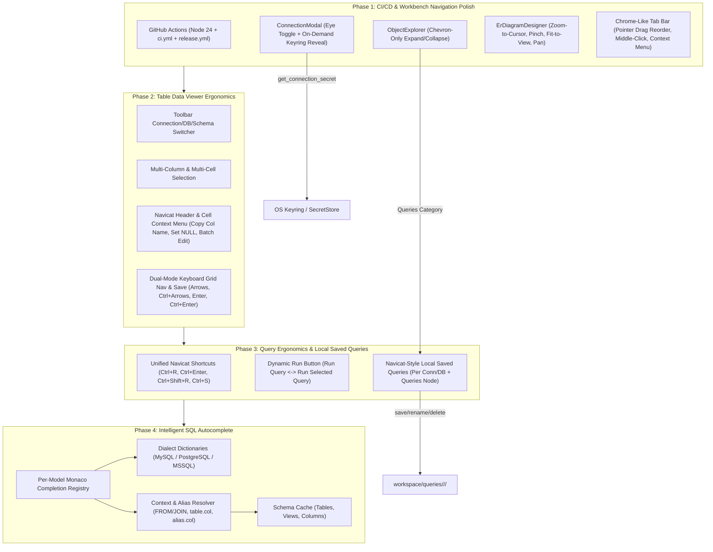

# Product Requirements Document (PRD) — DBa Improvements & Ergonomics

> **Status:** Completed — **Phase 1 ✅ Selesai** | **Phase 2 ✅ Selesai** | **Phase 3 ✅ Selesai** | **Phase 4 ✅ Selesai**  
> **Dokumen Induk:** [PRD.md](file:///home/angg/Projects/Desktop/DBa/doc/PRD.md) (Phase 1–5 Selesai ✅)  
> **Sumber Kebutuhan:** [improvement.md](file:///home/angg/Projects/Desktop/DBa/doc/improvement.md) (13 Poin Pengembangan)  
> **Target Pengguna:** Personal Daily-Driver (Single-User, Local-First, Cross-Platform Linux/macOS/Windows)  
> **Tujuan Iterasi:** Meningkatkan kenyamanan pakai harian (*daily-driver ergonomics*) secara menyeluruh — meliputi modernisasi CI/CD ke **Node.js 24**, navigasi workbench & tab ala Chrome, pengalaman **Table Data Viewer** ala Navicat (switcher DB, seleksi multi-kolom/multi-cell, klik kanan header kolom & cell, navigasi & simpan via keyboard), produktivitas **Query Editor** (shortcut Navicat, dynamic run button, local saved queries), hingga **SQL Autocomplete Engine** yang sadar dialek dan skema.

---

## 1. Ringkasan Eksekutif & Cakupan

Setelah seluruh fitur inti dan *power features* pada PRD awal (Phase 1–5) selesai diimplementasikan, pemakaian harian menunjukkan beberapa celah UX, produktivitas editor/grid, dan infrastruktur build yang perlu disempurnakan. Iterasi ini mengelompokkan seluruh **13 poin** di `doc/improvement.md` ke dalam **4 pilar utama**:

1. **Infrastruktur Build & Workbench Navigation Polish (Phase 1):** Memodernisasi GitHub Actions ke **Node.js 24** (+ workflow CI otomatis), tombol *show/hide password* dengan *on-demand OS Keyring reveal* di `ConnectionModal`, klik panah `(>)` terpisah di `ObjectExplorer`, zoom & pan interaktif (`Ctrl + Mouse Wheel`, *pinch-to-zoom*, *Fit to View*) di `ErDiagramDesigner`, serta **tab yang bisa digeser-geser ala Chrome** di `App.tsx`.
2. **Table Data Viewer Ergonomics ala Navicat (Phase 2):** Menambahkan informasi & *switcher* Connection/Database interaktif langsung di toolbar tabel (`DataViewer` & `MongoViewer`), **seleksi/blok 1 atau lebih kolom & rentang cell**, menu klik kanan lengkap pada **header kolom & cell/baris** (`Copy Column Name(s)`, `Set to NULL`, `Set to ""`, Copy TSV/CSV/JSON/INSERT SQL, Quick Filter, Hide/Show Columns, Duplicate/Delete Row), serta navigasi & simpan data penuh via keyboard (*Dual-Mode* Spreadsheet × Navicat dengan `ArrowUp`/`ArrowDown`, `Ctrl+ArrowLeft/Right`, `Enter`, dan `Ctrl+Enter`/`Ctrl+S`).
3. **Query Execution Ergonomics & Local Saved Queries ala Navicat (Phase 3):** Memperbaiki shortcut editor agar konsisten ala Navicat + IDE (`Ctrl+R`, `Ctrl+Enter`, `Ctrl+Shift+R`, `Ctrl+S`, `Ctrl+Shift+F`, `Esc`/`Ctrl+.`), tombol dinamis **`Run Query`** ↔ **`Run Selected Query`**, dan manajemen **Saved Queries** lokal terikat per Connection & Database (node `Queries` di tree).
4. **Dialect-Aware & Schema-Aware SQL Autocomplete Engine (Phase 4):** Memperluas autocomplete Monaco di `QueryEditor` agar mendukung *SQL keywords*, *built-in functions*, dan *data types* per dialek (**MySQL/MariaDB, PostgreSQL, MSSQL**), *context-aware ranking*, serta *dot-completion* berbasis tabel & alias (`users.`, `u.`).

### Status Progres Implementasi per Phase

| Phase | Fokus Utama | Status |
| :---: | :--- | :---: |
| **Phase 1** | CI/CD Node 24 Modernization & Workbench Navigation Polish | ✅ **Selesai (100%)** |
| **Phase 2** | Table Data Viewer Ergonomics (Navicat-Style Grid) | ✅ **Selesai (100%)** |
| **Phase 3** | Query Editor Ergonomics & Navicat-Style Local Saved Queries | ✅ **Selesai (100%)** |
| **Phase 4** | Dialect-Aware & Schema-Aware SQL Autocomplete Engine | ✅ **Selesai (100%)** |

### Pemetaan Kebutuhan `improvement.md` → Phase

| # | Poin di `improvement.md` | Area / Komponen Utama | Target Phase | Status |
| :-: | :--- | :--- | :---: | :---: |
| 1 | Upgrade Node.js & GitHub Actions (Node 20 deprecated → Node 24) | `.github/workflows/release.yml`, `.github/workflows/ci.yml` | **Phase 1** | ✅ |
| 2 | Tombol mata (*show/hide password*) di halaman buat/edit koneksi | `ConnectionModal.tsx`, `src-tauri/src/lib.rs`, `SecretStore` | **Phase 1** | ✅ |
| 3 | Klik nama tabel/node tidak auto collapse/expand; pakai tombol `(>)` | `ObjectExplorer.tsx` | **Phase 1** | ✅ |
| 4 | Zoom out/in di halaman ERD pakai `Ctrl + Mouse Wheel` dsb. | `ErDiagramDesigner.tsx` | **Phase 1** | ✅ |
| 5 | Tab object apapun bisa digeser-geser seperti di Chrome | `App.tsx`, `useWorkbenchStore.ts` | **Phase 1** | ✅ |
| 6 | Saat buka tabel tampilkan info asal DB + switcher gonta-ganti DB ala Navicat | `DataViewer.tsx`, `MongoViewer.tsx`, `App.tsx` | **Phase 2** | ✅ |
| 7 | Klik kanan pada cell/baris tabel (`Set to NULL` & opsi lengkap ala Navicat) | `DataViewer.tsx` | **Phase 2** | ✅ |
| 8 | Blok 1 atau lebih kolom/cell & menu klik kanan header kolom (`Copy Column Name`, dsb.) | `DataViewer.tsx` | **Phase 2** | ✅ |
| 9 | Kontrol keyboard di tabel (`↑`/`↓` baris, `Ctrl+←/→` kolom, `Enter` baris bawah, `Ctrl+Enter` simpan) | `DataViewer.tsx` | **Phase 2** | ✅ |
| 10 | Jalankan query pakai shortcut mirip Navicat | `QueryEditor.tsx`, `MongoQueryEditor.tsx`, `ObjectsBrowser.tsx` | **Phase 3** | ✅ |
| 11 | Tombol berubah dinamis: `Run Selected Query` ↔ `Run Query` | `QueryEditor.tsx` | **Phase 3** | ✅ |
| 12 | Save query di lokal ala Navicat | `QueryEditor.tsx`, `MongoQueryEditor.tsx`, `ObjectExplorer.tsx`, `ObjectsBrowser.tsx`, `workspace.rs` | **Phase 3** | ✅ |
| 13 | SQL suggestion (`sel...` → `SELECT`, `cre...` → `CREATE`, tabel, kolom) | `src/lib/sqlAutocomplete.ts`, `QueryEditor.tsx`, `dba-core` drivers | **Phase 4** | ✅ |

### Non-Goals (Di Luar Scope Iterasi Ini)
- Cloud sync / multi-user sharing untuk Saved Queries (penyimpanan tetap 100% lokal di folder workspace DBa).
- Drag tab keluar menjadi window OS terpisah (*tear-off windows*) — cakupan iterasi ini adalah reorder tab di dalam tab bar yang sama.
- Full SQL AST parser / static linter dengan squiggly error diagnostic di editor (fokus pada autocomplete cepat & akurat).
- Migrasi canvas ERD ke library eksternal baru (tetap menyempurnakan canvas ringan berbasis CSS transform + SVG yang sudah ada di `ErDiagramDesigner.tsx`).
- Penambahan engine database baru di luar 4 engine aktif (PostgreSQL, MySQL/MariaDB, MSSQL, MongoDB).

---

## 2. Arsitektur Perubahan & Aliran Data



---

## 3. Spesifikasi Fungsional Detail

### 3.1 CI/CD Modernization & Node.js 24 Upgrade (Phase 1)

**Kondisi Saat Ini:**
- `.github/workflows/release.yml` menggunakan `actions/checkout@v4`, `pnpm/action-setup@v4`, `actions/setup-node@v4` (`node-version: 22`), dan `tauri-apps/tauri-action@v0`. Runner GitHub Actions menampilkan warning depresiasi Node.js 20 dan memaksa action berjalan di Node.js 24.
- Belum ada workflow CI otomatis untuk memverifikasi *typecheck*, build frontend, dan kompilasi Rust pada setiap `push` / `pull_request`.

**Persyaratan:**
1. **Upgrade `.github/workflows/release.yml`:**
   - Naikkan seluruh action ke versi major terbaru yang berjalan native di **Node.js 24** (`actions/checkout@v6`, `actions/setup-node@v6`, versi `pnpm/action-setup` terbaru yang native Node 24 atau `pnpm/setup`, serta `tauri-apps/tauri-action@v1`; verifikasi `swatinem/rust-cache@v2`).
   - Naikkan `node-version` ke `24`.
   - Pertahankan runner `ubuntu-22.04` untuk build Linux agar binary `.AppImage`/`.deb`/`.rpm` tetap kompatibel dengan versi `glibc` pada distro Linux yang lebih luas.
   - Pastikan urutan step `pnpm` setup tetap berada sebelum `actions/setup-node` (jika memakai `cache: pnpm`).
2. **Workflow Baru `.github/workflows/ci.yml`:**
   - Trigger otomatis pada `push` (branch utama) dan `pull_request`.
   - Menjalankan validasi ringan berbasis Node.js 24:
     - Frontend: `pnpm install --frozen-lockfile` → `pnpm build` (`tsc && vite build`).
     - Backend Rust: `cargo check --workspace` dan `cargo test --workspace`.
   - Menggunakan caching (`pnpm` cache + `swatinem/rust-cache@v2`) agar durasi CI tetap cepat.

---

### 3.2 Show/Hide Password di Connection Modal (Phase 1)

**Kondisi Saat Ini:**
- `src/components/ConnectionModal.tsx` memiliki dua input password (`Database Password` di tab General dan `SSH Passphrase / Password` di tab SSH Tunnel) yang selalu bertipe `type="password"` tanpa tombol toggle.
- Saat mengedit koneksi tersimpan, password tidak dimuat dari `SecretStore` (hanya placeholder `•••••••• (unchanged)`).

**Persyaratan:**
1. **UI Toggle Mata (`Eye` / `EyeOff` dari `lucide-react`):**
   - Dipasang di sisi kanan dalam input **Database Password** (tab General) dan **SSH Passphrase / Password** (tab SSH Tunnel).
   - Memiliki atribut aksesibilitas jelas (`aria-label`, `title`: *"Show password"* / *"Hide password"*, `type="button"` agar tidak men-submit form).
2. **Perilaku saat Buat Koneksi Baru:**
   - Toggle mengubah tipe input antara `password` dan `text` secara instan untuk nilai yang sedang diketik user.
3. **Perilaku saat Edit Koneksi Tersimpan (*On-Demand Keyring Reveal*):**
   - Tambahkan Tauri command baru `get_connection_secret(connection_id: String, kind: "db" | "ssh") -> Option<String>` di `src-tauri/src/lib.rs` yang membaca dari `SecretStore::get_secret` menggunakan `keyring_ref` / `ssh.keyring_ref` milik profil koneksi terkait.
   - Saat user mengklik tombol mata pada field yang masih kosong padahal koneksi memiliki `keyringRef` (atau `ssh.keyringRef`), frontend memanggil `api.getConnectionSecret(...)`, lalu menampilkan password asli.
   - **Dirty Tracking Aman:** Sekadar mengintip password (tanpa mengedit isinya) tidak menimpa/mengubah secret jika user langsung klik Save; hanya nilai yang benar-benar dimodifikasi yang dikirim ulang ke `saveConnection`.
   - **Auto-Reset Keamanan:** Saat modal ditutup, berganti tab/koneksi yang diedit, atau selesai menyimpan, state `showPassword`, `showSshSecret`, dan buffer secret di memori komponen wajib di-reset kembali ke tersembunyi dan kosong.

---

### 3.3 Perilaku Klik Chevron-Only di Object Explorer (Phase 1)

**Kondisi Saat Ini:**
- Di `src/components/ObjectExplorer.tsx`, klik pada seluruh baris node Connection, Database, Schema, maupun Object Category (`Tables`, `Views`, `Functions`, dsb.) langsung memanggil `toggleExpand(...)` sekaligus mengubah `browserContext`.

**Persyaratan:**
1. **Pemisahan Hit-Area yang Konsisten di Semua Level Tree:**
   - Berlaku pada **Connection**, **Database**, **Schema**, dan **Object Categories** (`Tables`, `Collections`, `Views`, `Functions`, `Triggers`, `Indexes`, `Sequences`, `Enums / Types`, `Events`, dan `Queries`).
   - **Tombol Chevron `(>)` / `(v)`:** Merupakan tombol tersendiri (`<button onClick={(e) => { e.stopPropagation(); ... }}>`) dengan area klik nyaman (minimal `w-5 h-5` dengan hover highlight jelas). Hanya tombol inilah yang melakukan *collapse/expand* (serta memuat data anak / melakukan koneksi jika belum terkoneksi).
   - **Klik Tunggal pada Label / Area Baris:**
     - **Tidak pernah** mengubah status collapse/expand node.
     - Memilih node sebagai konteks aktif (`setBrowserContext(...)`) sehingga `ObjectsBrowser` di panel tengah langsung menampilkan isi node tersebut (dan melakukan `loadObjects` secara pasif jika cache kategori belum dimuat untuk koneksi yang sudah aktif).
     - Memperbarui highlight visual baris aktif (*selected state*) secara jelas walau node sedang dalam keadaan *expanded* maupun *collapsed*.
   - **Double-Click pada Label (Aksi Cepat):**
     - Pada *Connection* yang belum terkoneksi: langsung menjalankan `connectTo(conn.id)` dan membuka daftar database.
     - Pada *Database / Schema*: membuka node jika belum dimuat, atau langsung fokus ke daftar objeknya.
     - Pada *Leaf Object* (Table, View, Collection, Saved Query): membuka tab editor/viewer seperti perilaku yang sudah ada.

---

### 3.4 Kontrol Zoom & Navigasi Canvas ER Diagram (Phase 1)

**Kondisi Saat Ini:**
- `src/components/ErDiagramDesigner.tsx` merender canvas dengan `transform: translate(pan.x, pan.y) scale(zoom)` dan rentang zoom `0.4`–`2.0`, namun hanya dapat di-zoom melalui tombol toolbar `ZoomIn` / `ZoomOut`.

**Persyaratan:**
1. **Zoom-to-Cursor (`Ctrl/Cmd + Mouse Wheel` & Trackpad Pinch-to-Zoom):**
   - Pasang native `wheel` event listener pada container canvas dengan `{ passive: false }` agar `e.preventDefault()` mencegah zoom seluruh webview browser.
   - Saat `e.ctrlKey || e.metaKey` bernilai `true` (mencakup `Ctrl + Scroll` di mouse dan *pinch-to-zoom* di trackpad modern):
     - Hitung skala baru secara halus dan di-clamp pada rentang **`25%` – `300%` (`0.25` – `3.0`)**.
     - Hitung ulang `pan.x` dan `pan.y` agar titik canvas tepat di bawah kursor mouse tetap diam di posisi layar:
       $$\text{worldX} = \frac{\text{mouseX} - \text{pan}_x}{\text{zoom}_{\text{old}}}, \quad \text{pan}'_x = \text{mouseX} - \text{worldX} \times \text{zoom}_{\text{new}}$$
       (dan formula identik untuk sumbu $Y$).
2. **Scroll-to-Pan Canvas:**
   - Saat scroll wheel biasa **tanpa** `Ctrl`/`Cmd`: geser `pan` mengikuti `e.deltaX` dan `e.deltaY` (mendukung `Shift + Wheel` untuk pan horizontal pada mouse standar).
   - Drag klik kiri pada background canvas tetap berfungsi untuk panning.
3. **Keyboard Shortcuts & Toolbar Controls:**
   - Saat tab ER Diagram aktif (dan fokus tidak di input/textarea/select): `Ctrl/Cmd + =` / `+` (Zoom In), `Ctrl/Cmd + -` (Zoom Out), `Ctrl/Cmd + 0` (Reset 100%).
   - Tombol **Fit to View** di toolbar untuk menghitung *bounding box* seluruh tabel ER dan memusatkannya ke viewport canvas.
   - Klik pada angka persentase zoom (mis. `100%`) mereset zoom ke `100%`.

---

### 3.5 Chrome-Like Draggable & Manageable Tab Bar (Phase 1)

**Kondisi Saat Ini:**
- `src/App.tsx` merender tab secara statis dalam container flex tanpa kemampuan menggeser urutan tab, tanpa middle-click close, dan tanpa menu klik kanan tab. `useWorkbenchStore.ts` belum memiliki action `reorderTabs` atau bulk-close tabs.

**Persyaratan:**
1. **Pointer-Event Drag-and-Drop Reordering (Stabil di Linux WebKitGTK / macOS / Windows):**
   - Implementasikan drag reorder menggunakan **Pointer Events** (`onPointerDown` / `window pointermove` / `pointerup`) dengan ambang gerak (*drag threshold* sekitar `5px`) agar klik biasa tetap langsung mengaktifkan tab tanpa terasa *lag*, dan menghindari bug HTML5 DnD pada WebKitGTK di Tauri Linux.
   - **Tab `Objects` tetap pinned** di indeks `0` (paling kiri, tidak dapat digeser dan tab lain tidak dapat diletakkan di sebelah kirinya).
   - Semua tab lain (`table`, `query`, `designer`, `mongo_*`, `er_model`, `sync`, `data_transfer`, dsb.) dapat digeser bebas ke kiri/kanan.
   - Selama drag berlangsung: tampilkan visual feedback yang jelas (tab yang diseret tampak sedikit transparan/terangkat + garis indikator posisi drop vertikal berwarna aksen di antara tab tujuan, atau *live swap* mulus saat melewati titik tengah tab lain seperti Chrome).
   - Mendukung auto-scroll horizontal tab bar ketika tab diseret mendekati tepi kiri/kanan pada saat banyak tab terbuka.
2. **Store Actions di `useWorkbenchStore.ts`:**
   - `reorderTabs(fromId: string, toIndex: number)`: memindahkan tab dengan menjaga `objects` selalu di indeks `0` serta mempertahankan `activeTabId`, `secondaryTabId`, dan urutan *recovery tabs*.
   - `closeOtherTabs(keepId: string)`, `closeTabsToRight(id: string)`, `closeAllTabs()` (semuanya selalu mempertahankan tab `objects`).
3. **Chrome-Like Tab QoL:**
   - **Middle-Click (`e.button === 1` / `onAuxClick`):** Menutup tab yang diklik (kecuali `objects`).
   - **Right-Click Tab Context Menu:** Menyediakan aksi **Close**, **Close Others**, **Close Tabs to the Right**, dan **Close All**.

---

### 3.6 Table Data Viewer — Info & Switcher Database ala Navicat (Phase 2)

**Kondisi Saat Ini:**
- `src/components/DataViewer.tsx` dan `src/components/MongoViewer.tsx` tidak menampilkan informasi Connection maupun Database di toolbar, serta tidak menyediakan cara untuk mengganti database secara langsung dari tab tabel yang sedang terbuka.

**Persyaratan:**
1. **Toolbar Interactive Connection / Database / Schema Switcher (`DataViewer.tsx` & `MongoViewer.tsx`):**
   - Pada sisi kanan toolbar `DataViewer` (sejajar gaya dengan `QueryEditor.tsx`), tampilkan kontrol interaktif:
     - **Environment Indicator Dot** (Hijau Local/Dev, Kuning Staging, Merah Production) + dropdown **Connection** (terfilter sesuai paradigma: SQL connections untuk `DataViewer`, MongoDB connections untuk `MongoViewer`).
     - Dropdown **Database** (otomatis memuat daftar database milik koneksi aktif via `loadDatabases` bila belum ter-cache).
     - Dropdown **Schema** (muncul otomatis untuk PostgreSQL dan MSSQL, memuat via `loadSchemas`).
   - **Perilaku Saat Gonta-Ganti DB / Connection / Schema:**
     - Jika masih ada *staged changes* (`totalStagedCount > 0`) yang belum disimpan, tampilkan konfirmasi singkat (*"Discard unsaved changes and switch database?"*) agar perubahan user tidak hilang tidak sengaja.
     - Jika koneksi tujuan belum tersambung, otomatis jalankan `connectTo(newConnId)` terlebih dahulu.
     - Perbarui metadata tab via `updateTab(tab.id, { connectionId, database, schema })`, reset `page = 1` dan staged changes, lalu muat ulang data tabel dengan nama `tab.table` (atau `tab.collection` di `MongoViewer`) di database tujuan.
     - Jika tabel dengan nama yang sama tidak ditemukan di database tujuan, tampilkan banner informasi/error yang jelas beserta dropdown opsional untuk memilih tabel lain di database tujuan tersebut agar user tidak buntu.
2. **Identifikasi Jelas di Tab Header (`App.tsx`):**
   - Tambahkan `title` tooltip lengkap pada setiap tab tabel/collection/designer: `<connectionName> / <database>[.<schema>] / <table>`.
   - Jika terdapat dua atau lebih tab terbuka dengan nama tabel yang sama dari database/koneksi berbeda, tampilkan sub-label ringkas di judul tab (mis. `users` dengan badge kecil `@staging_db`) agar langsung terbedakan sekilas.

---

### 3.7 Table Data Viewer — Seleksi Multi-Kolom/Cell & Menu Klik Kanan ala Navicat (Phase 2)

**Kondisi Saat Ini:**
- Cell dan baris pada `src/components/DataViewer.tsx` belum memiliki `onContextMenu` sama sekali.
- Klik kiri pada header kolom langsung memanggil `toggleSort(col.name)`, dan belum ada mekanisme memblok/memilih 1 atau lebih kolom maupun rentang cell (*range selection*) atau menu klik kanan header kolom.

**Persyaratan:**
1. **Seleksi / Blok 1 atau Lebih Kolom & Rentang Cell:**
   - **Seleksi Header Kolom:**
     - Klik kiri pada area label header kolom memilih 1 kolom penuh (highlight lembut pada header + seluruh cell kolom tersebut).
     - `Ctrl/Cmd + Klik` pada header kolom menambah/melepas kolom dari seleksi non-berurutan (*multi-column select*).
     - `Shift + Klik` atau **drag klik kiri** melintasi beberapa header kolom memblok rentang kolom sekaligus.
     - **Sort tanpa bentrok:** Pindahkan aksi *toggle sort* pada header kolom ke tombol ikon sort kecil di sisi kanan header (atau double-click header / lewat menu klik kanan header kolom), sehingga klik/drag untuk memblok kolom terasa bersih tanpa mengubah urutan data secara tidak sengaja.
   - **Seleksi Rentang Cell (Multi-Cell / Multi-Kolom):**
     - Drag klik kiri atau `Shift + Klik` antar cell pada grid memblok persegi rentang cell (`startRow..endRow`, `startCol..endCol`) dengan highlight visual jelas.
     - Mendukung `Ctrl+C` cepat pada area yang diblok untuk menyalin nilai rentang terpilih dalam format TSV (langsung rapi saat di-paste ke Excel/Sheets/editor).
2. **Menu Klik Kanan Header Kolom & Multi-Seleksi (`DataViewer.tsx`):**
   - Klik kanan pada header kolom (atau area kolom/cell yang sedang diblok) mempertahankan seleksi yang sudah diblok jika target berada di dalam seleksi, lalu membuka context menu (dengan *viewport clamping*):
     - **Column Name Copy Actions:**
       - **Copy Column Name(s)** — menyalin nama 1 atau beberapa kolom yang diblok (dipisah koma, mis. `id, name, email`).
       - **Copy Column Name(s) (Newline)** — menyalin daftar nama kolom per baris baru.
     - **Selected Data Copy Actions:**
       - **Copy Selected Cells/Columns (TSV)** & **Copy With Headers**
       - **Copy Selected as CSV**
       - **Copy Selected as JSON**
       - **Copy Selected as INSERT SQL**
     - **Batch Value Actions** *(dinonaktifkan saat `isReadOnly`)*:
       - **Set Selected Cells to `NULL`** — men-stage `null` ke seluruh cell yang diblok sekaligus (termasuk semua baris halaman aktif jika 1+ kolom diblok penuh).
       - **Set Selected Cells to Empty String (`""`)** — men-stage `""` ke seluruh cell yang diblok.
     - **Sort & Filter Actions:**
       - **Sort Ascending**, **Sort Descending**, **Clear Sort**
       - **Filter by Column** — membuka Visual Filter Builder dengan kolom tersebut terpilih otomatis.
     - **Column Visibility Actions:**
       - **Hide Selected Column(s)** — menyembunyikan kolom dari tampilan grid sementara (dilengkapi indikator/tombol **Show All Columns** di toolbar & menu klik kanan bila ada kolom tersembunyi).
3. **Menu Klik Kanan Cell & Baris Tunggal (`DataViewer.tsx`):**
   - Klik kanan pada cell mana pun (baik baris data eksisting maupun baris `+NEW` *staged insert*) memunculkan context menu di posisi kursor (tertutup saat klik luar atau `Esc`):
     - **Value Actions** *(dinonaktifkan saat `isReadOnly` atau baris ditandai deleted)*:
       - **Set to `NULL`** — langsung men-stage nilai `null` pada cell (atau langsung commit jika *Instant Commit Mode* aktif).
       - **Set to Empty String (`""`)** — men-stage string kosong `""` (berbeda dari `NULL`).
       - **Edit Cell** — langsung membuka input edit inline pada cell tersebut.
       - **Undo Cell Change** *(aktif bila cell memiliki staged update)* — mengembalikan cell ke nilai aslinya dari database.
     - **Copy Actions:**
       - **Copy Cell Value** — menyalin nilai cell ke clipboard (`NULL` / string / JSON).
       - **Copy Column Name** — salin nama kolom tempat cell berada.
       - **Copy Row as JSON** — menyalin objek JSON `{ col: val, ... }` milik baris tersebut.
       - **Copy Row as INSERT SQL** — menghasilkan statement `INSERT INTO <table> (...) VALUES (...);` siap pakai sesuai dialek engine aktif.
       - **Copy Row as TSV** — menyalin baris berformat *tab-separated values*.
     - **Quick Filter Actions:**
       - **Filter by This Value** — menambahkan kondisi `col = <val>` (atau `col IS NULL` jika nilainya `null`) ke filter dan langsung menerapkan filter.
       - **Exclude This Value** — menambahkan kondisi `col != <val>` (atau `col IS NOT NULL`) dan langsung menerapkan filter.
     - **Foreign Key Action** *(muncul kondisional jika `col.fkTarget && cellVal != null`)*:
       - **Jump to Referenced Row (`target_table.target_col = val`)** — membuka tab tabel referensi yang terfilter.
     - **Row Actions** *(dinonaktifkan saat `isReadOnly`)*:
       - **Add Row** — menambah baris `+NEW` kosong baru.
       - **Duplicate Row** — menambah baris `+NEW` baru berisi salinan seluruh kolom baris terpilih (kecuali kolom Primary Key auto-increment yang diset `null`).
       - **Delete Row / Undo Delete Row** — menandai atau membatalkan penghapusan baris.

---

### 3.8 Table Data Viewer — Navigasi & Simpan Data via Keyboard (Phase 2)

**Kondisi Saat Ini:**
- `DataViewer.tsx` hanya melacak `selectedRowIdx` (tanpa fokus kolom/cell `selectedColIdx`), tidak ada navigasi panah di grid, dan hanya mendukung `Ctrl+S` untuk menyimpan *staged changes*.

**Persyaratan:**
1. **Active Cell Focus Model:**
   - Tambahkan state `activeCell: { isInsert: boolean; row: number; colIdx: number } | null` di `DataViewer.tsx` (di samping `selectedRowIdx`).
   - Cell yang sedang aktif memiliki ring fokus yang jelas (mis. `ring-2 ring-inset ring-indigo-500`) dan otomatis memperbarui `RightInspector` (`setInspectedCell`).
   - Setiap perpindahan cell otomatis menggulir container virtualizer secara vertikal (`rowVirtualizer.scrollToIndex`) dan horizontal (`scrollIntoView({ block: "nearest", inline: "nearest" })`) agar cell aktif selalu terlihat.
2. **Dual-Mode Keyboard Control (Spreadsheet × Navicat):**

| Tombol | Saat Mode Navigasi (Tidak Sedang Edit) | Saat Mode Edit (Kursor di Input Cell) |
| :--- | :--- | :--- |
| **`ArrowUp`** | Pindah ke baris sebelumnya (kolom tetap; termasuk naik dari baris 0 ke baris `+NEW`) | Commit nilai cell + pindah ke baris sebelumnya |
| **`ArrowDown`** | Pindah ke baris berikutnya (kolom tetap; termasuk turun dari `+NEW` ke baris 0) | Commit nilai cell + pindah ke baris berikutnya |
| **`Ctrl + ArrowLeft`** | Pindah ke kolom sebelumnya | Commit nilai cell + pindah ke kolom sebelumnya |
| **`Ctrl + ArrowRight`** | Pindah ke kolom berikutnya | Commit nilai cell + pindah ke kolom berikutnya |
| **`ArrowLeft` / `ArrowRight`** | Pindah ke kolom sebelumnya / berikutnya | Menggeser kursor teks di dalam input seperti biasa |
| **`Tab` / `Shift + Tab`** | Pindah ke kolom berikutnya / sebelumnya (wrap ke baris berikutnya/sebelumnya di ujung) | Commit nilai cell + pindah ke kolom berikutnya / sebelumnya |
| **`Enter`** | Pindah ke baris berikutnya (`row + 1`, kolom tetap) | Commit nilai cell + pindah ke baris berikutnya (`row + 1`, kolom tetap) |
| **`F2`** atau **Double-Click** | Masuk mode edit dengan nilai cell saat ini | — |
| **Ketik Karakter Printable** *(a-z, 0-9, simbol)* | Langsung masuk mode edit dengan karakter tersebut sebagai isi awal *(jika tidak Read-Only & tidak Deleted)* | Mengetik teks normal |
| **`Escape`** | — | Membatalkan edit saat ini dan kembali ke mode navigasi pada cell yang sama |
| **`Ctrl + Enter`** atau **`Ctrl + S`** | Langsung simpan (*Apply Staged Changes*) ke database bila ada perubahan | Commit edit cell aktif terlebih dahulu, lalu langsung simpan (*Apply Staged Changes*) ke database |
| **`Ctrl + Shift + N`** *(bonus Navicat)* | Langsung set cell aktif menjadi `NULL` | — |

3. **Sinkronisasi Commit Sebelum Simpan (`Ctrl+Enter` / `Ctrl+S`):**
   - Pastikan saat user menekan `Ctrl+Enter` tepat ketika masih berada di dalam `<input>` edit cell (sebelum `blur`), perubahan pada input aktif tersebut ikut digabungkan secara atomik ke payload `StagedChange[]` dan langsung dieksekusi ke database tanpa perlu menekan `Enter` dua kali!
   - Scoping listener keyboard: hanya aktif saat tab `DataViewer` tersebut sedang menjadi tab aktif (`activeTabId === tab.id`) dan fokus tidak sedang berada di input Visual Filter Builder atau modal lain.

---

### 3.9 Query Editor Shortcuts ala Navicat & Dynamic Run Button (Phase 3)

**Kondisi Saat Ini:**
- `QueryEditor.tsx` hanya mendaftarkan `Ctrl+Enter` pada `onMount` Monaco yang memanggil closure `handleRun` lama (*stale closure*).
- Tombol eksekusi statis bertuliskan `Run`.
- `MongoQueryEditor.tsx` belum memiliki keyboard shortcuts.
- `ObjectsBrowser.tsx` mendaftarkan listener `window` untuk `Ctrl+R` (Refresh Objects) yang berpotensi bentrok dengan `Ctrl+R` di Query Editor.

**Persyaratan:**
1. **Perbaikan Closure & Scoping Shortcut:**
   - Gunakan `useRef` (mis. `actionsRef`) di `QueryEditor.tsx` dan `MongoQueryEditor.tsx` agar seluruh command Monaco dan keyboard handler selalu memanggil versi terbaru (`handleRun`, `handleRunSelected`, `handleSave`, `handleBeautify`, `handleCancel`).
   - Batasi listener global `ObjectsBrowser.tsx` (`Ctrl+R`, `F5`, dsb.) agar hanya aktif ketika `activeTabId === "objects"`.
2. **Tabel Standar Shortcut (SQL & MongoDB Query Editor):**

| Aksi | Shortcut (Linux/Win) | Shortcut (macOS) | Cakupan |
| :--- | :--- | :--- | :--- |
| **Run Query / Run Selected** *(otomatis ikut blok)* | `Ctrl+R` atau `Ctrl+Enter` | `Cmd+R` atau `Cmd+Enter` | SQL & MongoDB |
| **Run Selected Query** *(eksplisit)* | `Ctrl+Shift+R` | `Cmd+Shift+R` | SQL |
| **Save Query** | `Ctrl+S` | `Cmd+S` | SQL & MongoDB |
| **Beautify / Format** | `Ctrl+Shift+F` | `Cmd+Shift+F` | SQL (SQL Formatter) & MongoDB (JSON Pretty) |
| **Stop / Cancel Running Query** | `Esc` atau `Ctrl+.` | `Esc` atau `Cmd+.` | SQL (saat `running === true`) |

3. **Dynamic Run Button (`QueryEditor.tsx`):**
   - Dengarkan `editor.onDidChangeCursorSelection` dan `onDidChangeModelContent` untuk melacak `hasSelection` (`!sel.isEmpty() && model.getValueInRange(sel).trim().length > 0`).
   - **Saat `hasSelection === false`:** Label tombol **`Run Query`** (tooltip `Run Query (Ctrl+R / Ctrl+Enter)`), mengeksekusi seluruh isi editor.
   - **Saat `hasSelection === true`:** Label tombol **`Run Selected Query`** (tooltip `Run Selected Query (Ctrl+R / Ctrl+Shift+R)`), dengan aksen warna pembeda halus (`bg-teal-600 hover:bg-teal-500`), mengeksekusi hanya teks yang diblok.
   - Saat `running === true`, tombol berubah menjadi **`Stop`** (`bg-red-600`, tooltip `Stop Query (Esc / Ctrl+.)`).

---

### 3.10 Local Saved Queries ala Navicat (Phase 3)

**Kondisi Saat Ini:**
- `QueryEditor.tsx` memanggil `window.prompt` lalu `api.saveQueryFile("", name, sql)` ke root `workspace/queries/`.
- Belum ada ikatan query ke `connectionId` & `database`, belum ada node `Queries` di bawah tiap database di `ObjectExplorer.tsx`, belum ada modal Save/Save As/Rename/Delete, dan `MongoQueryEditor.tsx` belum mendukung penyimpanan query.

**Persyaratan:**
1. **Struktur Penyimpanan Lokal (Workspace-First & Ramah Git):**
   - Tetap disimpan secara lokal di direktori workspace DBa:
     ```text
     workspace/queries/
     ├── <connection_id>/
     │   └── <database_name>/
     │       ├── report_monthly.sql
     │       └── active_users.mongodb.json   # untuk MongoDB MQL / Pipeline
     └── legacy_global_query.sql             # tetap terbaca (backward-compatible)
     ```
   - Perbarui model `SavedQuery` (`crates/dba-core/src/models.rs` & `src/types/dba.ts`) dengan field opsional `connectionId?: string`, `database?: string`, `schema?: string`, `engine?: DbEngine`.
   - Lengkapi Tauri commands CRUD: `save_query_file` (mendukung overwrite path & metadata folder conn/db), `rename_saved_query(old_path, new_name)`, `duplicate_saved_query(path, new_name)`, dan `delete_saved_query(path)` dengan validasi path traversal ketat.
2. **Integrasi UI ala Navicat (`ObjectExplorer`, `ObjectsBrowser`, `NavicatToolbar`):**
   - Tambahkan kategori **`Queries`** di `OBJECT_CATEGORIES` pada `ObjectExplorer.tsx` di bawah setiap database/schema (sejajar dengan *Tables*, *Views*, *Functions*), menampilkan jumlah saved query milik database tersebut.
   - Klik label **`Queries`** di `ObjectExplorer` (atau tombol ribbon **`Query`** bila ditambahkan di `NavicatToolbar.tsx`) menampilkan daftar saved query untuk database aktif pada `ObjectsBrowser.tsx` (`browserContext.category === "query"`).
   - Menu klik kanan / aksi pada saved query di sidebar & `ObjectsBrowser`: **Open Query**, **Rename**, **Duplicate**, **Delete** (dengan konfirmasi).
   - Membuka saved query otomatis mengisi `connectionId`, `database`, `sql`, `savedQueryPath`, dan `dirty: false` pada `WorkbenchTab`.
   - File lama di root `workspace/queries/` tetap muncul di bagian *Global Saved Queries*.
3. **Alur Save & Save As Tanpa `window.prompt`:**
   - Ganti `window.prompt` dengan komponen **Save Query Modal** (input nama file, preview lokasi `Connection / Database`, validasi karakter ilegal, konfirmasi jika menimpa nama yang sudah ada).
   - **First Save (`Ctrl+S` / `Save`):** Membuka modal → menulis file lokal → menandai tab dengan `savedQueryPath`, mengubah judul tab ke `<name>.sql`, menghapus indikator `dirty` (`•`), dan me-refresh daftar query.
   - **Subsequent Save (`Ctrl+S` / `Save`):** Langsung menimpa `savedQueryPath` tanpa modal ulang + toast singkat *"Saved <name>.sql"*.
   - **Save As:** Menyimpan salinan baru tanpa menimpa file sebelumnya.
   - **Dukungan `MongoQueryEditor`:** Tombol `Save` & `Save As` + `Ctrl+S` untuk menyimpan state MQL / Aggregation Pipeline ke `.mongodb.json`.

---

### 3.11 Dialect-Aware & Schema-Aware SQL Autocomplete Engine (Phase 4)

**Kondisi Saat Ini:**
- `QueryEditor.tsx` mendaftarkan `monaco.languages.registerCompletionItemProvider("sql", ...)` di setiap instance tab (berpotensi duplikasi/konflik antar tab) dan hanya mengembalikan daftar mentah tabel & kolom dari `schemaCacheRef` tanpa SQL keywords, tanpa functions, dan tanpa analisis konteks/alias.

**Persyaratan:**
1. **Arsitektur Singleton Registry per Model URI (`src/lib/sqlAutocomplete.ts`):**
   - Daftarkan hanya **satu** global `CompletionItemProvider` untuk bahasa `"sql"` (trigger characters `[".", " ", "\`", "\""]`).
   - Setiap instance `QueryEditor` mendaftarkan konteksnya (engine aktif, `schemaCache`, `database`, `schema`) ke `Map<modelUri, EditorCompletionContext>` dan membersihkannya saat unmount.
2. **Kamus SQL per Dialek:**
   - **SQL Core Keywords:** `SELECT`, `FROM`, `WHERE`, `CREATE`, `ALTER`, `DROP`, `INSERT INTO`, `VALUES`, `UPDATE`, `SET`, `DELETE FROM`, `JOIN`, `INNER JOIN`, `LEFT JOIN`, `RIGHT JOIN`, `FULL OUTER JOIN`, `CROSS JOIN`, `ON`, `GROUP BY`, `HAVING`, `ORDER BY`, `ASC`, `DESC`, `LIMIT`, `OFFSET`, `DISTINCT`, `UNION`, `UNION ALL`, `CASE`, `WHEN`, `THEN`, `ELSE`, `END`, `AS`, `AND`, `OR`, `NOT`, `IN`, `EXISTS`, `BETWEEN`, `LIKE`, `IS NULL`, `IS NOT NULL`, `WITH`, `PRIMARY KEY`, `FOREIGN KEY`, `REFERENCES`, `INDEX`, `VIEW`, `TABLE`, `DATABASE`, `TRUNCATE`, `EXPLAIN`, dll.
   - **MySQL / MariaDB:** `SHOW TABLES`, `SHOW DATABASES`, `SHOW CREATE TABLE`, `DESCRIBE`, `USE`, `AUTO_INCREMENT`, `ENGINE=InnoDB`, `DEFAULT CHARSET=utf8mb4`, `ON DUPLICATE KEY UPDATE`, `REPLACE INTO`, `REGEXP`, `UNSIGNED`; tipe data (`INT`, `BIGINT`, `VARCHAR`, `TEXT`, `DECIMAL`, `DATETIME`, `TIMESTAMP`, `JSON`, `ENUM`); fungsi (`COUNT()`, `SUM()`, `AVG()`, `CONCAT()`, `COALESCE()`, `IF()`, `IFNULL()`, `NOW()`, `CURDATE()`, `DATE_FORMAT()`, `DATEDIFF()`, `GROUP_CONCAT()`, `JSON_EXTRACT()`, `JSON_UNQUOTE()`, `LOWER()`, `UPPER()`, `TRIM()`, `SUBSTRING()`, `CAST()`, `ROUND()`).
   - **PostgreSQL:** `RETURNING`, `ILIKE`, `ON CONFLICT`, `DO NOTHING`, `DO UPDATE SET`, `LATERAL`, `MATERIALIZED VIEW`, `SERIAL`, `BIGSERIAL`, `UUID`, `JSONB`, `TIMESTAMPTZ`, `ANALYZE`, `VACUUM`, `DISTINCT ON`; fungsi (`COALESCE()`, `STRING_AGG()`, `ARRAY_AGG()`, `JSONB_AGG()`, `JSONB_BUILD_OBJECT()`, `TO_CHAR()`, `DATE_TRUNC()`, `AGE()`, `NOW()`, `EXTRACT()`, `GENERATE_SERIES()`, `ROW_NUMBER()`).
   - **SQL Server (MSSQL):** `TOP`, `FETCH NEXT`, `ROWS ONLY`, `CROSS APPLY`, `OUTER APPLY`, `IDENTITY`, `NVARCHAR`, `UNIQUEIDENTIFIER`, `DATETIME2`, `NOLOCK`, `MERGE`, `OUTPUT`, `EXEC`; fungsi (`ISNULL()`, `GETDATE()`, `SYSDATETIME()`, `DATEADD()`, `DATEDIFF()`, `CONVERT()`, `STRING_AGG()`, `LEN()`, `CHARINDEX()`, `FORMAT()`).
   - **Quick Snippets:** Mis. `sel` → `SELECT` & snippet `SELECT * FROM ...`; `cre` → `CREATE`, `CREATE TABLE ...`, `CREATE INDEX ...`.
3. **Schema-Aware & Context-Aware Intelligence:**
   - **Prefix Matching Natural:** `sel` → `SELECT`; `cre` → `CREATE`; `us` → tabel `users` (ikon Struct + detail `Table`); `em` → kolom `email` (detail `users.email`).
   - **Context-Aware Ranking (`sortText`):**
     - Setelah `FROM`, `JOIN`, `INTO`, `UPDATE`, `TABLE`, `TRUNCATE`, `DESCRIBE`: prioritaskan **Tabel & View**.
     - Setelah `SELECT`, `WHERE`, `ON`, `AND`, `OR`, `GROUP BY`, `ORDER BY`, `HAVING`, `SET`: prioritaskan **Kolom** (terutama dari tabel yang dirujuk di query aktif) + **Functions** + **Keywords**.
   - **Table & Alias Dot-Completion (`users.` / `u.`):**
     - Parser ringan mengekstrak daftar `FROM/JOIN <table> [AS] <alias>` pada statement aktif (mendukung backtick, double quote, dan bracket).
     - Saat mengetik `<table_or_alias>.`, popup autocomplete secara spesifik menampilkan kolom milik tabel tersebut.
   - **Reliable Schema Refresh:**
     - Otomatis memuat ulang `getAutocompleteSchema` saat tab dibuka, saat ganti Connection/Database, dan setelah menjalankan DDL (`CREATE`/`ALTER`/`DROP`), serta tombol refresh schema manual di toolbar `QueryEditor`.
     - Pastikan driver `mysql.rs`, `postgres.rs`, dan `mssql.rs` menyertakan kolom dari **Tables & Views**.

---

## 4. Persyaratan Non-Fungsional & Kualitas

| Aspek | Target |
| :--- | :--- |
| **Autocomplete Latency** | < 30 ms per keystroke (100% di memori frontend; 0 network roundtrip saat mengetik) |
| **ERD Zoom & Tab Drag Smoothness** | 60 fps saat `Ctrl + Wheel`, *pinch-to-zoom*, pan, dan drag reorder tab |
| **Data Grid Keyboard Responsiveness** | < 16 ms perpindahan fokus cell pada tabel 100.000 baris (tervirtualisasi penuh) |
| **Keamanan Kredensial** | Secret hasil reveal di `ConnectionModal` tidak pernah dicatat ke `addLog`, `localStorage`, atau file JSON; otomatis dibersihkan saat unmount/close |
| **Backward Compatibility** | Saved queries lama di root `workspace/queries/` tetap terbaca dan bisa dikelola |
| **Cross-Platform Shortcuts** | Mendukung `Ctrl` di Linux/Windows dan `Cmd` (`metaKey` / `KeyMod.CtrlCmd`) di macOS |
| **Zero CI Warnings** | Workflow `release.yml` dan `ci.yml` berjalan bersih tanpa peringatan depresiasi Node.js 20 |

---

## 5. Roadmap & Strategi Phasing (4 Fase)

Menggunakan pendekatan bertahap **Infra & Navigation Polish → Table Data Viewer Ergonomics → Query Editor & Saved Queries → Intelligent SQL Autocomplete** agar setiap fase fokus pada satu area kohesif, mudah diuji, dan langsung terasa manfaatnya di pemakaian harian.

### Phase 1 — CI/CD Node 24 Modernization & Workbench Navigation Polish ✅ Selesai
*Target: Pipeline build bersih tanpa warning Node 20, ditambah perbaikan UX berdampak tinggi di Connection Modal, Object Explorer, ER Diagram, dan Chrome-like Tab Bar.*

- [x] **CI/CD & Node.js 24:**
  - [x] Upgrade `.github/workflows/release.yml` ke Node.js 24 (`actions/checkout@v6`, `actions/setup-node@v6`, pnpm setup Node 24-compatible, `tauri-apps/tauri-action@v1`, verifikasi `swatinem/rust-cache@v2`), pertahankan `ubuntu-22.04` untuk kompatibilitas Linux AppImage.
  - [x] Buat `.github/workflows/ci.yml` untuk validasi otomatis `pnpm build`, `cargo check --workspace`, dan `cargo test --workspace` pada `push` dan `pull_request`.
- [x] **Connection Modal — Show/Hide Password:**
  - [x] Tambah Tauri command `get_connection_secret(connection_id, kind)` di `src-tauri/src/lib.rs` dan wrapper di `src/lib/tauri.ts`.
  - [x] Pasang tombol mata (`Eye` / `EyeOff`) pada **Database Password** dan **SSH Passphrase / Password** di `src/components/ConnectionModal.tsx` dengan *on-demand Keyring reveal*, *dirty tracking* aman, dan *auto-reset* saat modal ditutup.
- [x] **Object Explorer — Chevron-Only Expand/Collapse:**
  - [x] Refactor seluruh level node di `src/components/ObjectExplorer.tsx` (Connection, Database, Schema, Categories) agar hanya tombol chevron `(>)`/`(v)` yang melakukan toggle collapse/expand.
  - [x] Klik tunggal pada label hanya memilih node & memperbarui `ObjectsBrowser` (plus double-click label tetap untuk aksi cepat connect/open).
- [x] **ER Diagram — Zoom-to-Cursor & Canvas Navigation:**
  - [x] Implementasikan `Ctrl/Cmd + Mouse Wheel` dan *trackpad pinch-to-zoom* dengan **zoom-to-cursor** (`25%–300%`) di `src/components/ErDiagramDesigner.tsx`.
  - [x] Tambahkan scroll-to-pan (wheel tanpa `Ctrl`), shortcut `Ctrl++`/`Ctrl+-`/`Ctrl+0`, klik persentase zoom untuk reset `100%`, serta tombol **Fit to View** di toolbar.
- [x] **Chrome-Like Draggable Tab Bar:**
  - [x] Tambah `reorderTabs`, `closeOtherTabs`, `closeTabsToRight`, dan `closeAllTabs` di `src/store/useWorkbenchStore.ts` (menjaga `objects` tetap pinned di indeks `0`).
  - [x] Implementasikan drag-and-drop reorder berbasis Pointer Events (dengan indikator posisi drop & auto-scroll), middle-click close, dan context menu klik kanan tab di `src/App.tsx`.

**Kriteria Selesai (Acceptance Criteria) Phase 1:**
- `ci.yml` & `release.yml` berjalan tanpa warning depresiasi Node.js 20.
- Tombol mata di `ConnectionModal` dapat menampilkan password baru maupun mengintip password tersimpan dari OS Keyring, lalu otomatis tertutup saat modal ditutup.
- Mengklik label `Tables` / database / schema di `ObjectExplorer` tidak mengubah status collapse/expand; hanya tombol `(>)` yang men-toggle tree.
- `Ctrl + Mouse Wheel` pada ER Diagram men-zoom tepat ke posisi kursor tanpa men-zoom keseluruhan aplikasi.
- Tab apapun selain `Objects` dapat digeser-geser mulus di tab bar, ditutup lewat middle-click, dan memiliki menu klik kanan ala Chrome.

---

### Phase 2 — Table Data Viewer Ergonomics (Navicat-Style Grid) ✅ Selesai
*Target: Pengalaman membuka, berpindah DB, mengedit via klik kanan, dan navigasi/simpan keyboard di tabel setara Navicat.*

- [x] **Interactive Connection / Database / Schema Switcher:**
  - [x] Tambahkan dropdown interaktif Connection, Database, dan Schema (untuk PG/MSSQL) + indikator environment di toolbar kanan `src/components/DataViewer.tsx` dan `src/components/MongoViewer.tsx`.
  - [x] Tangani perpindahan DB secara aman (konfirmasi bila ada *staged changes* belum tersimpan, auto-connect bila perlu, reload tabel yang sama di DB baru, serta fallback pesan/pemilih tabel jika tabel tidak ada di DB tujuan).
  - [x] Tambahkan tooltip asal DB lengkap di tab header `App.tsx` + sub-label DB otomatis bila ada nama tabel kembar dari DB berbeda.
- [x] **Multi-Column & Multi-Cell Selection + Column Header Context Menu:**
  - [x] Implementasikan seleksi 1 atau lebih kolom lewat klik kiri / `Ctrl+Klik` / `Shift+Klik` / drag pada header kolom serta seleksi rentang multi-cell lewat drag / `Shift+Klik` di grid (`DataViewer.tsx`), lengkap dengan `Ctrl+C` cepat (TSV).
  - [x] Pisahkan pemicu *Sort* di header kolom ke ikon sort / double-click / context menu agar tidak bentrok dengan seleksi kolom.
  - [x] Tambahkan menu klik kanan header kolom & multi-seleksi: `Copy Column Name(s)` (koma / baris baru), `Copy Selected` (TSV / With Headers / CSV / JSON / INSERT SQL), batch `Set Selected to NULL` / `""`, `Sort ASC/DESC/Clear`, `Filter by Column`, dan `Hide / Show All Columns`.
- [x] **Navicat Cell & Row Right-Click Context Menu:**
  - [x] Implementasikan context menu klik kanan pada cell/baris `DataViewer.tsx` (dengan *viewport clamping*):
    - Value Actions: `Set to NULL`, `Set to Empty String ("")`, `Edit Cell`, `Undo Cell Change`.
    - Copy Actions: `Copy Cell Value`, `Copy Column Name`, `Copy Row as JSON`, `Copy Row as INSERT SQL`, `Copy Row as TSV`.
    - Quick Filter: `Filter by This Value`, `Exclude This Value` + FK Jump kondisional.
    - Row Actions: `Add Row`, `Duplicate Row`, `Delete Row` / `Undo Delete Row`.
- [x] **Dual-Mode Keyboard Navigation & Save (`DataViewer.tsx`):**
  - [x] Tambahkan state fokus cell `activeCell` (baris + kolom, termasuk baris `+NEW`) dengan auto-scroll vertikal & horizontal.
  - [x] Implementasikan kontrol keyboard lengkap: `ArrowUp`/`ArrowDown` (pindah baris), `ArrowLeft`/`ArrowRight` & `Ctrl+ArrowLeft/Right` & `Tab`/`Shift+Tab` (pindah kolom), `Enter` (commit & pindah baris berikutnya), `F2`/double-click/langsung ketik karakter (masuk mode edit), `Esc` (batal edit), `Ctrl+Shift+N` (`Set to NULL`), dan **`Ctrl+Enter` / `Ctrl+S`** (commit edit aktif secara atomik lalu langsung simpan *staged changes* ke DB).

**Kriteria Selesai (Acceptance Criteria) Phase 2:**
- Tab tabel menampilkan asal Connection & Database dan user dapat langsung mengganti DB dari toolbar untuk memuat tabel di DB tujuan.
- User dapat memblok 1 atau beberapa kolom/cell lewat drag/`Ctrl+Klik`/`Shift+Klik`, lalu klik kanan untuk menjalankan `Copy Column Name(s)`, `Copy Selected` (TSV/CSV/JSON/INSERT SQL), batch `Set Selected to NULL`, `Sort`, atau `Hide/Show Columns`.
- Klik kanan cell dapat langsung menjalankan `Set to NULL`, `Copy Row as INSERT SQL`, `Filter by This Value`, dan `Duplicate Row`.
- User dapat menavigasi seluruh grid memakai `ArrowUp`/`ArrowDown` dan `Ctrl+ArrowLeft/Right`, mengetik nilai baru, menekan `Enter` untuk turun ke baris berikutnya, lalu menekan `Ctrl+Enter` untuk langsung menyimpan perubahan ke database tanpa menyentuh mouse.

---

### Phase 3 — Query Editor Ergonomics & Navicat-Style Local Saved Queries ✅ Selesai
*Target: Pengalaman menulis, menjalankan, dan menyimpan query terasa secepat dan senatural Navicat.*

- [x] **Navicat Shortcuts & Bug Fixes:**
  - [x] Perbaiki *stale closure* pada handler shortcut Monaco di `src/components/QueryEditor.tsx` menggunakan ref terkini.
  - [x] Terapkan standar shortcut penuh di `QueryEditor.tsx` & `MongoQueryEditor.tsx`: `Ctrl+R` / `Ctrl+Enter` (Run / Run Selected), `Ctrl+Shift+R` (Run Selected), `Ctrl+S` (Save), `Ctrl+Shift+F` (Beautify), `Esc` / `Ctrl+.` (Stop Query).
  - [x] Batasi scope shortcut `Ctrl+R` di `src/components/ObjectsBrowser.tsx` agar hanya aktif ketika tab `objects` yang sedang fokus.
- [x] **Dynamic Run Button:**
  - [x] Track seleksi editor secara real-time (`onDidChangeCursorSelection` & `onDidChangeModelContent`) di `QueryEditor.tsx`.
  - [x] Ubah label tombol secara dinamis antara **`Run Query`** (tanpa blok teks) dan **`Run Selected Query`** (saat ada teks diblok) beserta tooltip shortcut yang sesuai.
- [x] **Navicat-Style Local Saved Queries:**
  - [x] Perluas model `SavedQuery` & storage di `crates/dba-core/src/storage/workspace.rs` untuk menyimpan query terstruktur per `<connection_id>/<database>/` sekaligus tetap membaca file legacy di root `workspace/queries/`.
  - [x] Tambah Tauri commands `rename_saved_query` dan `duplicate_saved_query` serta perluas `save_query_file` untuk overwrite & binding metadata koneksi/database (`.sql` dan `.mongodb.json`).
  - [x] Buat komponen **Save Query Modal** (gantikan `window.prompt`), dukung alur Navicat: First Save → Modal, `Ctrl+S` berikutnya → overwrite langsung + toast, serta tombol **Save As** di `QueryEditor.tsx` dan `MongoQueryEditor.tsx`.
  - [x] Tambahkan kategori **`Queries`** di bawah setiap database pada `ObjectExplorer.tsx`, hubungkan ke `ObjectsBrowser.tsx` (`category: "query"`), serta lengkapi menu klik kanan **Open / Rename / Duplicate / Delete**.

**Kriteria Selesai (Acceptance Criteria) Phase 3:**
- Memblok sebagian query di `QueryEditor` langsung mengubah tombol menjadi **`Run Selected Query`**; melepas blok mengembalikannya ke **`Run Query`**.
- Menekan `Ctrl+R` atau `Ctrl+Enter` selalu menjalankan SQL/seleksi terkini pada koneksi & database aktif tanpa pernah terbentur refresh `ObjectsBrowser`.
- Menekan `Ctrl+S` pada query baru memunculkan Save Query Modal dan menyimpannya ke `workspace/queries/<conn>/<db>/`; menekan `Ctrl+S` kedua kalinya langsung menimpa tanpa modal; query muncul di node `Queries` bawah database tersebut dan saat dibuka kembali langsung terikat ke koneksi & database asalnya.

---

### Phase 4 — Dialect-Aware & Schema-Aware SQL Autocomplete Engine ✅ Selesai
*Target: Saran pengetikan SQL instan, akurat sesuai dialek engine, dan pintar memahami tabel, kolom, serta alias.*

- [x] **Arsitektur Completion Provider Terpusat:**
  - [x] Buat modul `src/lib/sqlAutocomplete.ts` dengan singleton Monaco `CompletionItemProvider` dan registry konteks per `model.uri` (menghilangkan duplikasi antar tab).
- [x] **Kamus Dialek SQL Lengkap:**
  - [x] Definisikan daftar keyword, klausa, tipe data, fungsi bawaan, dan snippet ringan untuk **MySQL/MariaDB**, **PostgreSQL**, dan **SQL Server (MSSQL)**.
- [x] **Context-Aware & Alias Dot-Completion:**
  - [x] Implementasikan deteksi konteks klausa (`FROM`/`JOIN`/`INTO`/`UPDATE` → prioritaskan tabel & view; `SELECT`/`WHERE`/`ON`/`GROUP BY`/`ORDER BY`/`SET` → prioritaskan kolom, fungsi, keyword).
  - [x] Implementasikan parser ringan ekstraktor `table` + `alias` agar mengetik `users.` atau `u.` memunculkan daftar kolom spesifik milik tabel `users`.
- [x] **Sinkronisasi Schema Cache Andal:**
  - [x] Pastikan `getAutocompleteSchema` di `mysql.rs`, `postgres.rs`, dan `mssql.rs` mencakup tables + views serta cepat di-refresh saat user ganti koneksi/database atau menjalankan perintah DDL (`CREATE`/`ALTER`/`DROP`).
  - [x] Tambahkan tombol/aksi *Refresh Autocomplete Schema* pada toolbar `QueryEditor.tsx` bila user mengubah skema dari luar aplikasi.

**Kriteria Selesai (Acceptance Criteria) Phase 4:**
- Mengetik `sel` di koneksi MySQL langsung memunculkan `SELECT` teratas; mengetik `cre` memunculkan `CREATE`; mengetik `us` memunculkan tabel `users` (bila ada di database aktif).
- Menulis `SELECT u. FROM users u` lalu mengetik setelah `u.` memunculkan daftar kolom tabel `users` dengan detail `users.<kolom>`.
- Membuka 3+ tab Query Editor pada koneksi/dialek berbeda (mis. MySQL dan PostgreSQL) tidak menghasilkan saran duplikat atau tercampur antar tab.

---

## 6. Langkah Selanjutnya

Setelah PRD ini disetujui, implementasi dapat langsung dimulai secara bertahap mulai dari **Phase 1** (upgrade CI/CD Node.js 24, tombol mata `ConnectionModal`, chevron-only `ObjectExplorer`, zoom-to-cursor `ErDiagramDesigner`, dan Chrome-like draggable tab bar), dilanjutkan verifikasi build lokal (`pnpm build` & `cargo check --workspace`) di akhir setiap phase.
