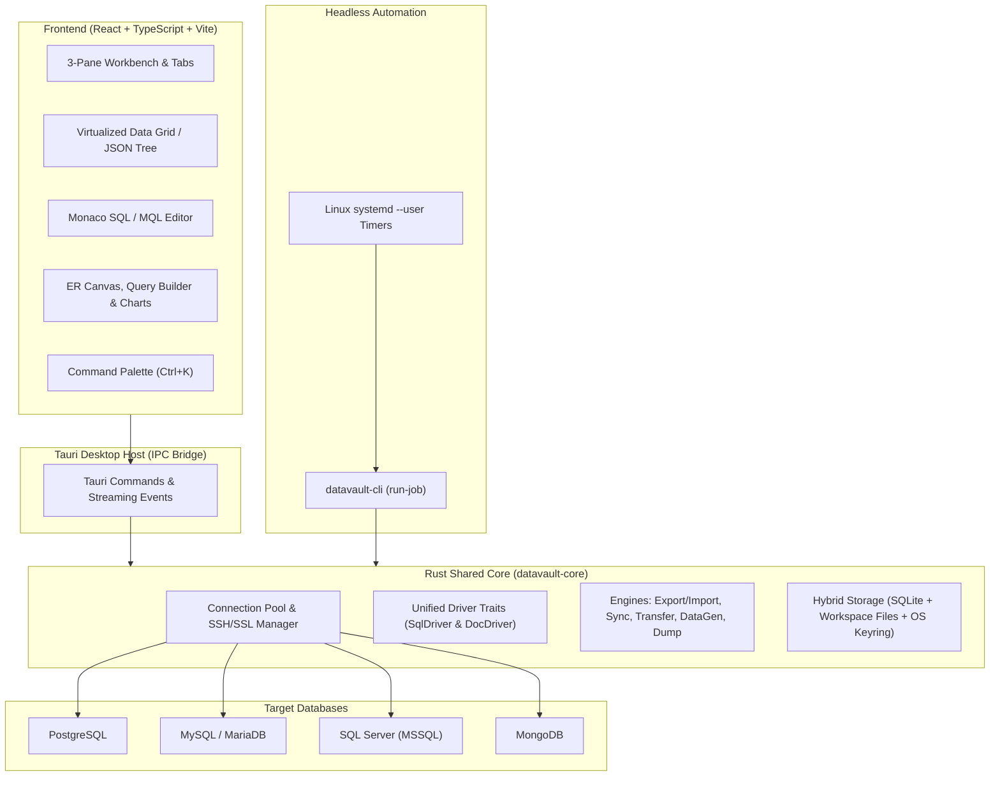

# Product Requirements Document (PRD) — Datavault

> **Status:** Complete Implementation (Phase 1–5 Selesai ✅)  
> **Target Pengguna:** Personal Daily-Driver (Single-User, Local-First, Linux-First)  
> **Visi Produk:** Membangun aplikasi desktop Multi-Database Manager yang cepat, ringan, aman, dan modern berbasis **Tauri (Rust + React/TypeScript)** dengan paritas fitur penuh ala **Navicat Premium** untuk **PostgreSQL, MySQL/MariaDB, SQL Server (MSSQL), dan MongoDB**.

---

## 1. Ringkasan Eksekutif & Tujuan

**Datavault** dirancang sebagai pengganti pribadi Navicat Premium di desktop Linux yang:
1. **Ringan & Cepat (Native Feel):** Memanfaatkan Rust untuk manajemen koneksi, driver database, streaming data besar, SSH tunneling, dan background automation — menghindari beban RAM tinggi ala Electron dan masalah rendering GTK/Wine di Linux.
2. **Paritas Fitur Penuh Navicat Premium:** Mencakup 4 pilar workbench inti (*Object Explorer*, *Data Viewer/Editor*, *Query Editor*, *Object Designer*) dan 8 *power features* utama (*Import/Export & Dump*, *Structure/Data Sync*, *Data Transfer*, *Visual ER Diagram*, *Visual Query Builder*, *Automation/Scheduler*, *Charts*, *Data Generation*).
3. **Dual-Paradigm Engine:** Mendukung database **Relational SQL** (PostgreSQL, MySQL/MariaDB, MSSQL) dan **Document NoSQL** (MongoDB) dalam satu antarmuka yang kohesif.
4. **Aman & Portabel:** Kredensial tersimpan terenkripsi di OS Keyring, dilengkapi *Production Safety Guard*, serta penyimpanan aset kerja berbasis file `.sql`/`.json` yang ramah Git/Syncthing.

### Non-Goals (Di Luar Scope Saat Ini)
- Multi-user SaaS, team collaboration cloud sync, billing, atau RBAC server.
- Integrasi **AI SQL Assistant** *(tidak masuk scope v1–v5, namun UI & command registry dirancang modular agar mudah ditambahkan di masa depan)*.
- HTTP PHP Tunneling legacy.
- Database engine tambahan di luar daftar 4 target (seperti Oracle, SQLite user-facing, Redis) — namun tetap dimungkinkan lewat trait driver modular.

---

## 2. Arsitektur Sistem & Tech Stack

### 2.1 High-Level Architecture

Datavault menggunakan struktur **Rust Workspace (Monorepo)** agar seluruh logika koneksi, driver, transfer, sync, dan backup bisa dipakai bersama oleh **Desktop GUI (Tauri)** dan **Headless CLI Runner (`datavault-cli`)** untuk scheduled jobs.



### 2.2 Pilihan Teknologi

| Layer | Teknologi yang Direkomendasikan | Alasan |
| :--- | :--- | :--- |
| **Desktop Shell** | **Tauri v2** | Footprint RAM/binary kecil, native Linux Wayland/X11 integration, security boundary ketat |
| **Backend Core** | **Rust** (`tokio`, `serde`, `thiserror`, `tracing`) | Kinerja tinggi untuk streaming jutaan baris, type-safe, mudah dikompilasi jadi GUI + CLI |
| **DB Drivers (Rust)** | `tokio-postgres`, `mysql_async`, `tiberius` (MSSQL), `mongodb` (official) | Async native Rust, mendukung metadata detail & streaming cursor |
| **SSH & TLS** | `russh` (pure Rust SSH tunnel) + `rustls` | Tidak butuh wrapper proses `ssh` eksternal, kontrol lifecycle tunnel penuh |
| **Local Storage** | `rusqlite` (SQLite + FTS5) + `keyring` (Linux Secret Service / KWallet) | Pencarian history cepat & keamanan rahasia setara sistem operasi |
| **Frontend UI** | **React 19 + TypeScript + Tailwind CSS + Zustand** | Ekosistem komponen kaya untuk workbench kompleks |
| **Data Grid** | **TanStack Table + TanStack Virtual** (atau Canvas-backed grid) | Mampu render puluhan ribu baris di memori secara mulus (60fps) |
| **Code Editor** | **Monaco Editor** | Autocomplete schema-aware, multi-cursor, syntax highlighting SQL/JSON/JS |
| **Visual Canvas** | **React Flow (`@xyflow/react`)** | Ideal untuk Visual ER Diagram & Visual Query Builder interaktif |
| **Charts** | **Apache ECharts** | Sangat lengkap (Bar, Line, Area, Pie, Scatter, Heatmap, Export PNG/SVG) |

---

## 3. Spesifikasi Fitur Inti (4 Pilar Workbench)

### 3.1 Connection Manager, Networking & Keamanan
- **Multi-Engine Profiles:** Mendukung PostgreSQL, MySQL/MariaDB, MSSQL, dan MongoDB.
- **Quick URI Import:** Paste URI (`postgres://`, `mysql://`, `mongodb+srv://`, dsb.) untuk mengisi form koneksi otomatis.
- **SSH Tunneling:** Mendukung autentikasi password maupun SSH private key (`id_ed25519`/`id_rsa` + passphrase) dan custom jump/bastion host.
- **SSL / TLS Configuration:** Mendukung mode verify (`disable`, `prefer`, `require`, `verify-ca`, `verify-full`), custom CA cert, client cert, dan client key.
- **Credential Security:** Password database, URI secret, dan passphrase SSH **tidak pernah** ditulis dalam plaintext ke file JSON. Semua disimpan di **OS Keyring** (fallback: encrypted vault dengan master password berbasis Argon2id + AES-256-GCM).
- **Connection Organization:** Folder/Groups bertingkat, pencarian koneksi, dan **Environment Color Tags** (mis. Hijau = Local/Dev, Kuning = Staging, Merah = Production).
- **Production Safety Guard:**
  - Strip/badge warna merah jelas di header tab untuk koneksi Production.
  - Toggle **Read-Only Mode** per koneksi (memblokir semua operasi tulis di level driver/executor).
  - Konfirmasi ekstra otomatis (menampilkan SQL/MQL yang akan berjalan) sebelum eksekusi `UPDATE`/`DELETE` tanpa `WHERE`, `DROP`, `TRUNCATE`, atau setiap operasi tulis di environment Production.

### 3.2 Object Explorer (Left Navigation Tree)
- **Hierarchical Tree:**
  - *PostgreSQL:* Connection → Database → Schema → Tables, Views, Materialized Views, Functions, Procedures, Triggers, Indexes, Sequences, Enums/Types.
  - *MySQL / MariaDB:* Connection → Database → Tables, Views, Functions, Procedures, Events, Triggers, Indexes.
  - *MSSQL:* Connection → Database → Schema → Tables, Views, Stored Procedures, Functions, Triggers, Indexes.
  - *MongoDB:* Connection → Database → Collections, Views, Indexes, Aggregation Pipelines.
- **Quick Filter & Search:** Filter tree secara real-time, serta navigasi cepat objek melalui **Command Palette (`Ctrl+K`)**.
- **Context Menu Lengkap:** Open Table, Design Table, Dump SQL, Empty/Truncate, Duplicate Table, Copy DDL, Refresh, Delete/Drop.

### 3.3 Data Viewer & Inline Editor
- **Dual-Paradigm View Modes:**
  - *Relational:* Spreadsheet Grid View (virtualized) + **Form View** (1 baris vertikal untuk tabel dengan banyak kolom) + **Cell Inspector** (JSON pretty-print, Long Text, Hex/Binary viewer, Date/Time picker).
  - *MongoDB:* **Tree View** (collapsible BSON/JSON), **Raw JSON View**, dan **Flattened Table View**.
- **Navigasi & Filter Visual:**
  - Visual Filter Builder (multi-kondisi `=`, `!=`, `LIKE`, `IN`, `IS NULL`, range tanggal) yang langsung menerjemahkan filter ke `WHERE` atau MongoDB Filter JSON.
  - Multi-column sorting, server-side pagination (custom page size, mis. 100/500/1000 baris), dan **Foreign Key Jump** (klik nilai FK untuk langsung melompat ke baris referensi di tabel tujuan).
- **Mekanisme Edit Data — Mode Hybrid:**
  - **Default: Staged Changes + Preview SQL.** Setiap *insert* (hijau), *update* (kuning), dan *delete* (merah) ditampung secara lokal terlebih dahulu. User dapat membuka modal **Preview SQL / Operations**, lalu tekan `Ctrl+S` (**Apply Changes**) untuk mengeksekusi semuanya dalam satu transaksi atomik (atau membatalkan per-cell/keseluruhan via *Discard*).
  - **Toggle: Navicat Instant Row-Commit.** User dapat mengaktifkan mode commit langsung per baris (klik ✓ atau pindah baris langsung eksekusi) pada koneksi non-Production, dilengkapi kontrol transaksi manual (`Begin`, `Commit`, `Rollback`).

### 3.4 Query Editor & Produktivitas
- **Multi-Tab & Multi-Connection:** Setiap tab query terikat pada koneksi & database/schema aktif yang mudah diganti lewat dropdown toolbar.
- **Schema-Aware Autocomplete:** Caching metadata lokal (tabel, alias, kolom, fungsi, keyword dialek SQL / operator MongoDB `$match`, `$group`, dsb.) untuk saran pengetikan instan.
- **Eksekusi Fleksibel:** Run All (`Ctrl+Enter`), Run Selected / Current Statement, Stop/Cancel Query (mengirim cancel signal ke server DB), dan **Multiple Result Sets** (tiap statement tampil di sub-tab hasil terpisah).
- **Visual Explain Plan:** Menjalankan `EXPLAIN ANALYZE` (PG/MySQL), `SHOWPLAN_XML` (MSSQL), atau `.explain("executionStats")` (MongoDB) dan menampilkannya sebagai pohon biaya eksekusi (cost tree) + highlight *Full Table Scan* / *Seq Scan*.
- **SQL Formatter / Beautify**, **Saved Queries** (tersimpan rapi di folder workspace), **Code Snippets** (parameterized templates), dan **Full-Text Searchable Query History** (tercatat waktu eksekusi, durasi, jumlah baris, dan status error).
- **MongoDB Query & Aggregation Editor:** Mendukung query MQL standar serta **Stage-by-Stage Aggregation Pipeline Builder** dengan preview hasil di setiap tahap (`$match` → `$lookup` → `$group` → `$sort`).

### 3.5 Object & Table Designer
- **GUI Table Designer (SQL):** Tabular editor untuk Columns (nama, tipe data spesifik engine, length/precision, nullable, default, auto-increment/identity, comment), Primary Keys, Indexes (B-Tree, Hash, GIN, Unique, Partial), Foreign Keys (`ON UPDATE`/`ON DELETE`), Check Constraints, dan Triggers.
- **Live DDL Preview:** Setiap perubahan di GUI langsung menghasilkan preview `CREATE TABLE` / `ALTER TABLE` yang sesuai dialek engine sebelum diterapkan.
- **MongoDB Collection Designer:** Edit Indexes (single, compound, TTL, text, partial), JSON Schema Validation rules, dan Capped Collection options.

---

## 4. Spesifikasi Power Features (Paritas Navicat Premium)

### 4.1 Import / Export Wizard & Dump / Execute SQL (Strategi Hybrid)
- **Built-in Rust Streaming Engine (Zero-Dependency):**
  - **Export & Import Wizard:** Mendukung **CSV**, **JSON / JSONL**, **Excel (`.xlsx`)**, dan **SQL Insert/Upsert**. Dilengkapi *column mapping*, transformasi tipe data, pilihan delimiter/encoding, error handling policy (*stop on error* vs *skip & log*), serta progress bar + cancel.
  - **Built-in SQL Dump & Execute SQL File:** Streaming dump struktur + data (chunked inserts) dan eksekusi file `.sql` berukuran besar (ratusan MB hingga GB) secara streaming tanpa memuat seluruh file ke RAM.
- **Native CLI Integration (Opsional, Auto-Detect):**
  - Deteksi otomatis binary resmi jika terinstal di PATH (`pg_dump`/`pg_restore`, `mysqldump`/`mysql`, `mongodump`/`mongorestore`, `sqlpackage`/`bcp`) dengan UI wizard yang memetakan flag populer (custom binary format, parallel jobs, compression, BSON archive) untuk backup produksi skala gigabyte.

### 4.2 Structure Synchronization & Data Synchronization
- **Structure Sync:** Membandingkan metadata skema antara *Source* dan *Target* (lintas environment, mis. Dev → Staging/Prod), menampilkan diff visual (*New*, *Modified*, *Deleted* tables/columns/indexes/FKs), mengizinkan user memilih objek mana yang akan disinkronkan, menghasilkan skrip migrasi DDL lengkap untuk direview, lalu mengeksekusinya.
- **Data Sync:** Membandingkan isi baris tabel berbasis Primary Key (atau custom key) menggunakan streaming hash/chunk comparison, menampilkan ringkasan *Insert / Update / Delete*, preview diff per baris, dan eksekusi sinkronisasi transaksional.

### 4.3 Data Transfer (Same-Engine & Cross-Engine)
- Menyalin tabel, view, atau seluruh database dari satu server ke server lain — **termasuk lintas engine** (mis. MySQL → PostgreSQL, MSSQL → PostgreSQL, atau Relational Table → MongoDB Collection dan sebaliknya).
- Dilengkapi **Type Mapping Matrix** otomatis yang dapat disesuaikan user sebelum transfer dimulai, serta opsi *Drop & Recreate*, *Append*, atau *Upsert*, dan dapat disimpan sebagai *Transfer Profile* yang reusable.

### 4.4 Visual ER Diagram / Data Modeling
- **Reverse Engineering:** Tarik database/schema yang sudah ada menjadi diagram ER interaktif otomatis (auto-layout *Dagre/Elk* + manual drag & group).
- **Interactive Modeling:** Tambah/edit tabel, kolom, dan tarik garis relasi Foreign Key (1:1, 1:N, N:M) langsung di canvas dengan notasi Crow's Foot / UML.
- **Forward Engineering & Sync to DB:** Generate skrip `CREATE`/`ALTER` SQL dari model ER atau langsung bandingkan model dengan database live via Structure Sync.
- **Export Diagram:** Simpan sebagai PNG, SVG, atau PDF untuk dokumentasi.

### 4.5 Visual Query Builder
- Drag-and-drop tabel/view ke canvas, otomatis mendeteksi atau memungkinkan user menarik garis `JOIN` (`INNER`, `LEFT`, `RIGHT`, `FULL`).
- Centang kolom untuk `SELECT`, atur alias, agregasi (`COUNT`, `SUM`, `AVG`), `WHERE`, `GROUP BY`, `HAVING`, `ORDER BY`, dan `LIMIT`.
- **Two-Way Live SQL Preview:** Perubahan visual langsung meng-update kode SQL yang bisa langsung dijalankan atau dikirim ke tab Query Editor.

### 4.6 Backup & Automation (Scheduled Jobs)
- **Batch Jobs:** Gabungkan satu atau lebih tugas (Backup/Dump, Export, Data Transfer, Structure/Data Sync, atau Run Saved Query) ke dalam satu *Batch Job* berurutan dengan aturan stop/continue saat error.
- **Headless Rust CLI Runner + Linux `systemd --user` Timers:**
  - GUI menyediakan *Schedule Builder* (Cron / Daily / Weekly / Interval).
  - Saat jadwal disimpan, Datavault secara otomatis men-generate unit `.service` dan `.timer` di `~/.config/systemd/user/` yang memanggil `datavault-cli run-job <job_id>` (dan menjalankannya dengan `systemctl --user enable --now`).
  - **Keunggulan:** Jadwal berjalan mulus walau GUI ditutup, **0 MB RAM saat idle**, mengakses kredensial dari OS Keyring secara aman, menulis hasil ke SQLite execution log, dan mengirim notifikasi desktop Linux (`notify-send` / D-Bus) saat job selesai atau gagal.

### 4.7 Charts / Data Visualization
- Mengubah hasil query SQL/MongoDB menjadi visualisasi interaktif (Bar, Stacked Bar, Line, Area, Pie/Donut, Scatter, KPI Card) lewat panel konfigurasi X-axis, Y-axis, Series/Grouping.
- Mendukung **Multi-Chart Dashboard Workspace** yang terikat ke Saved Queries (tinggal klik *Refresh All* untuk memperbarui data) serta export grafik ke PNG/SVG.

### 4.8 Data Generation (Dummy / Mock Data)
- Memilih tabel target dan jumlah baris yang ingin dibuat (mis. 1.000 – 1.000.000 baris).
- Deteksi otomatis generator berdasarkan nama & tipe kolom (*UUID*, *Full Name*, *Email*, *Phone*, *Address*, *Date Range*, *Integer/Decimal Range*, *Regex pattern*, *Enum list*, serta **Foreign Key-aware sampling** agar integritas relasional tetap valid).
- Menggunakan batch/bulk insert (`COPY` di PG, multi-row `INSERT` di MySQL/MSSQL, `insertMany` di MongoDB) agar pembuatan ratusan ribu baris selesai dalam hitungan detik.

---

## 5. Desain UI/UX & Penyimpanan Lokal

### 5.1 Layout Workbench (Modern Navicat 17 × IDE)
- **3-Panel Adaptif:**
  - **Left Sidebar:** Connection Tree & Object Explorer (collapsible, resizable, filter cepat).
  - **Center Workspace:** Multi-tab area (mendukung *split view* horizontal/vertikal untuk membandingkan dua tabel atau query), ditambah **Bottom Drawer** yang bisa dilipat (SQL Console Log, Query Execution History, Output/Messages).
  - **Right Inspector (Collapsible):** Metadata objek terpilih, Cell JSON/Text viewer, Saved Snippets, atau Filter/Sort summary.
- **Top Compact Header:** Quick connection switcher, environment indicator bar, tombol aksi kontekstual (New Query, New Table, Transfer, Sync, Model, Automation), dan pemicu **Command Palette (`Ctrl+K`)**.
- **Theming & Keyboard-First:**
  - **Dark Mode** sebagai default (palet high-contrast nyaman dipakai lama, cocok dengan desktop Linux modern), plus **Light Mode** dan **Follow System**.
  - Shortcut lengkap (`Ctrl+K` Command Palette, `Ctrl+T` New Query Tab, `Ctrl+W` Close Tab, `Ctrl+Enter` Run Query, `Ctrl+S` Apply Staged Changes / Save Query, `Ctrl+F` Find/Filter).

### 5.2 Hybrid Local Storage & Portability

Lokasi penyimpanan mengikuti standar **XDG Base Directory Specification** di Linux:

```text
~/.local/share/datavault/
├── datavault.db              # SQLite lokal (Query History + FTS5, Job Logs, Schema Cache, App State)
└── workspace/                # Folder ramah Git / Syncthing (100% tanpa password/secret)
    ├── connections.json      # Metadata koneksi (host, port, user, ssh host, color tag, keyring_ref)
    ├── queries/              # Saved SQL & MQL files (.sql, .mongodb.js) terorganisir per folder
    ├── snippets/             # Code snippets (.json)
    ├── models/               # Visual ER Diagrams (.dvmodel.json)
    ├── charts/               # Chart & Dashboard definitions (.dvchart.json)
    └── jobs/                 # Transfer, Sync, Import/Export & Batch Job profiles (.dvjob.json)
```

- **Rahasia & Kredensial:** Seluruh password DB, SSH passphrase, dan path/isi secret disimpan di **Linux OS Keyring** (via `org.freedesktop.secrets`), hanya direferensikan lewat `keyring_ref` UUID di `connections.json`.

---

## 6. Persyaratan Non-Fungsional (Performance & Reliability)

| Aspek | Target |
| :--- | :--- |
| **Cold Startup Time** | < 1,5 detik di desktop Linux modern |
| **Idle Memory Usage** | < 150 MB RAM (Tauri + 1 koneksi terbuka); **0 MB** untuk background scheduler (`systemd` timer) |
| **Large Result Set** | Mampu memuat & scroll 100.000 baris di grid secara smooth (60fps) via virtualization + server-side paging default |
| **Query Cancellation** | Setiap query panjang dapat dibatalkan kapan saja tanpa membuat UI freeze |
| **Crash & Data Safety** | Unsaved SQL tabs & staged edits di-autosave sementara ke SQLite recovery table agar tidak hilang saat crash |
| **Error Transparency** | Pesan error asli dari database (SQLSTATE, line/column position, MongoDB error code) ditampilkan jelas + highlight baris error di editor |

---

## 7. Roadmap & Strategi Phasing (5 Fase)

Menggunakan pendekatan **Depth-First Core** agar aplikasi sudah produktif dipakai harian sejak akhir Phase 1.

### Phase 1 — Core Workbench (PostgreSQL + MySQL/MariaDB) *[MVP Daily Driver]* — ✅ Selesai
- [x] Setup Rust Workspace (`datavault-core`, `datavault-tauri`, `datavault-cli`) + Frontend React/TS + Tauri v2.
- [x] Hybrid Storage (SQLite + Workspace folder) + OS Keyring integration.
- [x] Connection Manager lengkap: PostgreSQL & MySQL/MariaDB, SSH Tunnel, SSL/TLS, Connection Groups, Color Tags, Production Safety Guard (Read-Only + Konfirmasi).
- [x] 3-Pane Modern Workbench UI, Dark/Light/System Theme, Command Palette (`Ctrl+K`).
- [x] Object Explorer (Tables, Views, Functions, Procedures, Triggers, Indexes).
- [x] Data Viewer & Inline Editor (Virtualized Grid, Form View, Cell Inspector, Visual Filter Builder, FK Jump, Hybrid Staged Changes + Preview SQL & Toggle Instant Commit).
- [x] Query Editor (Monaco, Schema-Aware Autocomplete, Multiple Result Sets, Cancel Query, Visual Explain Plan, Beautify, History, Saved Queries, Snippets).
- [x] GUI Table Designer (Columns, Indexes, FKs, Checks + Live DDL Preview).

### Phase 2 — Multi-Engine Expansion (SQL Server / MSSQL & MongoDB) — ✅ Selesai
- [x] Implementasi driver **MSSQL (`tiberius`)**: dukungan schema, Stored Procedures, `SHOWPLAN_XML`, Table Designer dialek T-SQL, dan pagination (`OFFSET FETCH`).
- [x] Implementasi driver **MongoDB (`mongodb`)**: Collections, Views, Indexes, Validation Designer.
- [x] **NoSQL UI Suite:** Document Tree View, Raw JSON View, Flattened Grid View, inline document editor (staged/commit), MQL Query Editor, dan **Stage-by-Stage Aggregation Pipeline Builder**.

### Phase 3 — Data Mobility (Import/Export, Dump/Restore & Data Transfer) — ✅ Selesai
- [x] Built-in Rust Streaming **Import / Export Wizard** (CSV, JSON/JSONL, Excel `.xlsx`, SQL Insert/Upsert) dengan column mapping & reusable profiles.
- [x] Built-in **SQL Dump & Streaming Execute SQL File** + auto-detect **Native CLI Wrapper** (`pg_dump`/`pg_restore`, `mysqldump`, `mongodump`/`mongorestore`, `bcp`/`sqlpackage`).
- [x] **Data Transfer Wizard** (same-engine & cross-engine dengan Type Mapping Matrix yang bisa dikustomisasi).

### Phase 4 — Schema Intelligence & Visual Design (Sync, ER Model & Query Builder) — ✅ Selesai
- [x] **Structure Synchronization** (schema diff viewer + selective DDL migration generator).
- [x] **Data Synchronization** (streaming row-hash diff + transactional sync script).
- [x] **Visual ER Diagram / Data Modeling** (Reverse Engineering, auto-layout, interactive Crow's Foot editor, Forward Engineering ke SQL, export PNG/SVG/PDF).
- [x] **Visual Query Builder** (drag-and-drop tables/joins + live SQL generation).

### Phase 5 — Automation, Analytics & Testing Utilities — ✅ Selesai
- [x] **Batch Jobs & Scheduled Automation** via `datavault-cli` + integrasi otomatis `systemd --user` timers + riwayat log & Linux desktop notifications.
- [x] **Charts & Dashboard Builder** (Bar, Stacked Bar, Line, Area, Pie/Donut, Scatter, KPI Card; multi-chart dashboard terikat Saved Queries, export PNG/SVG).
- [x] **Data Generation Engine** (FK-aware dummy/mock data generator dengan bulk-insert berkecepatan tinggi).

---

## 8. Langkah Selanjutnya

Jika PRD ini sudah sesuai dengan visimu:
1. Buka direktori `/home/angg/.gemini/antigravity/scratch/datavault/` sebagai active workspace.
2. Verifikasi toolchain lokal (Rust/Cargo, Node/pnpm, Tauri Linux dependencies seperti `webkit2gtk`) sebelum memulai **Phase 1**.
